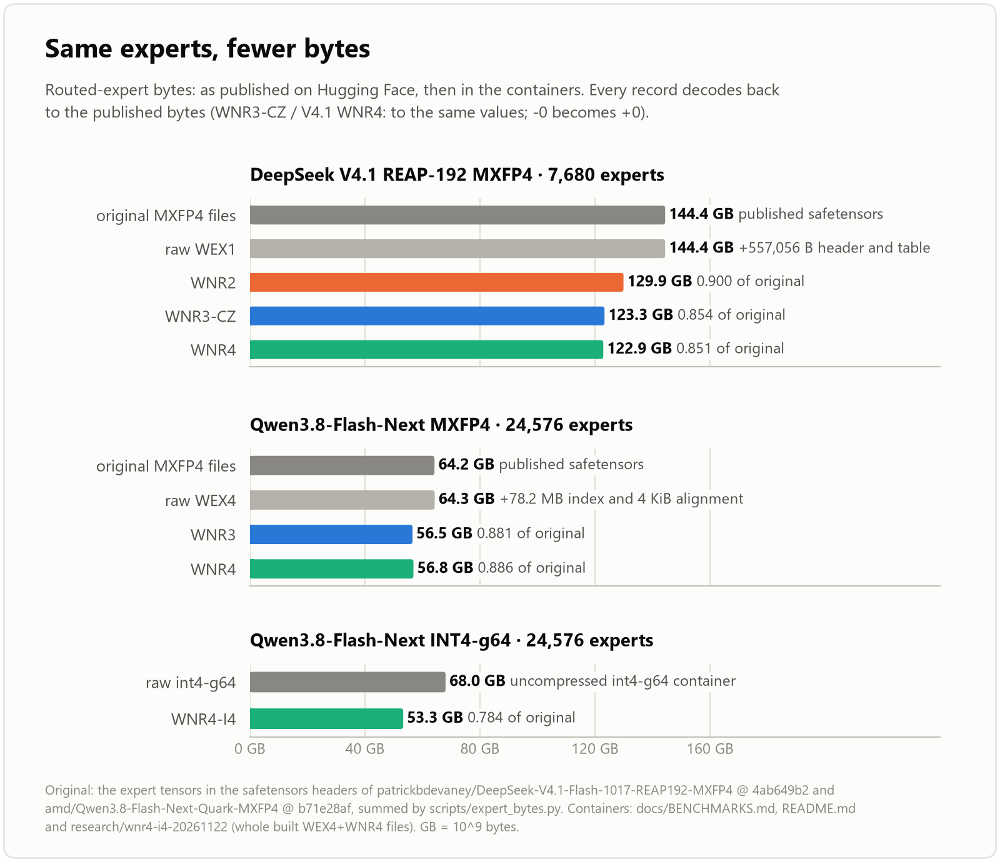
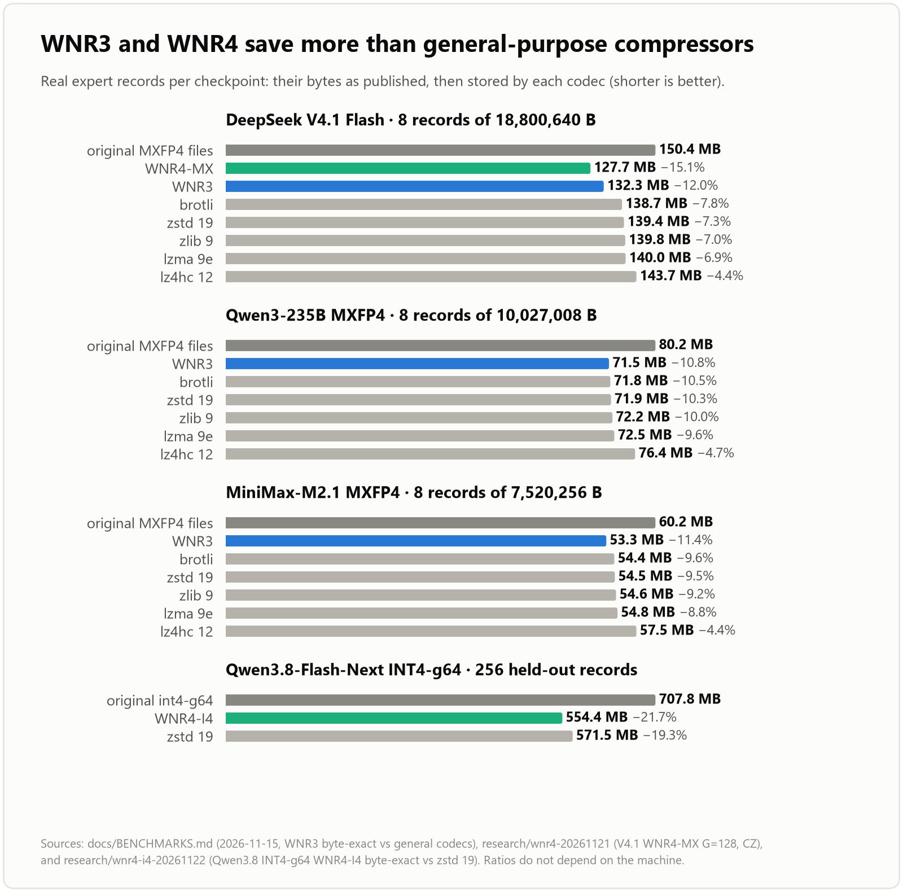
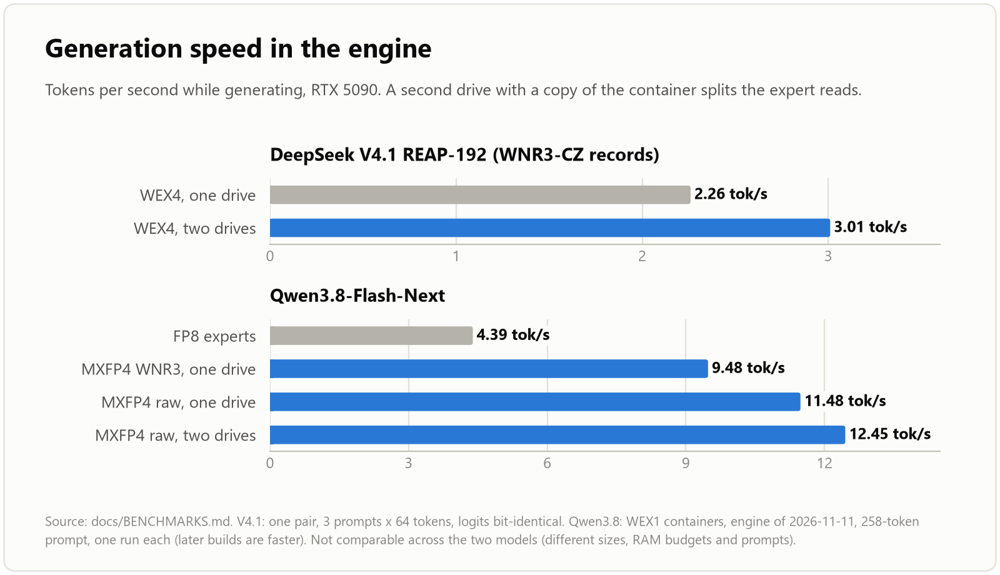
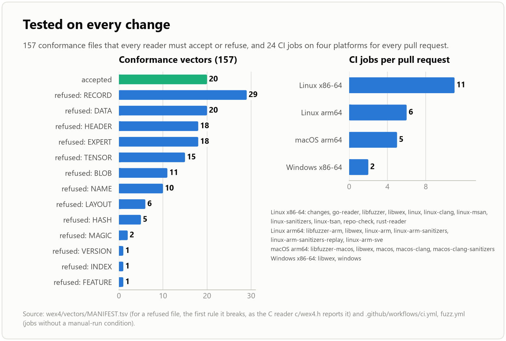

<p align="center">
  <picture>
    <source media="(prefers-color-scheme: dark)" srcset="assets/wex-logo-dark.svg">
    
  </picture>
</p>

# WEX

WEX is a file format for keeping the "expert" blocks of large Mixture-of-Experts AI models on an SSD, so that a program can load each block with one fast read. **WEX is lossless: a program reads back exactly the weights that were stored. It does not quantize, round or prune anything.**

## In plain words

A Mixture-of-Experts model is split into hundreds of small blocks of weights called *experts*, and only a few of them work on each word. When the model is too big for the computer's memory, the program keeps some experts in memory and reads the others from the SSD the moment they are needed. A WEX file is where those experts are kept, laid out so that each one comes off the disk in a single read.

**Think of a ZIP file.** When you zip a document and unzip it later, you get the same document back, every letter in place; the ZIP was only a smaller way to keep it. WEX works the same way for expert weights:

- **WEX4** is the file layout: one slot per expert, and a fingerprint (SHA-256) of every slot. An uncompressed ("RAW") slot holds the expert's original bytes, unchanged.
- **WNR3** is optional compression inside it, like ZIP: it makes a 4-bit expert 12-15% smaller (0.880 of its uncompressed size for Qwen3.8-Flash-Next, 0.854 for DeepSeek V4.1 REAP-192, over whole files), and unpacking gives back the same weights. In one optional mode, *canonical zero*, a zero written as "-0" comes back written as "+0": the same number, like writing 0 or -0 on paper (details below).

**Where precision is lost: before WEX.** To *quantize* is to round numbers to fewer bits so that they take less space; the rounding cannot be undone. The published expert files hold 4-bit weights (MXFP4; int4 for one Sage-S2.1-Flash file). Turning a model's 16-bit or 8-bit weights into 4-bit numbers is a quantization, and it does lose some precision, but it happens before WEX: DeepSeek publishes the experts of DeepSeek V4.1 in MXFP4, and the Qwen3.8-Flash-Next experts used here were quantized by AMD with AMD-Quark. The DeepSeek V4.1 model used here is also pruned by a third party (REAP-192: 192 of the 384 experts of each layer kept), which is lossy too. The Sage-S2.1-Flash files published next to the WEX files were requantized by us from the official FP8 release; that step is lossy and its quality was not measured. WEX then stores those weights as they are.

| Step | Lossy? | Done by |
|---|---|---|
| quantizing the weights to 4 bits | yes | before WEX: the model's publisher, a third party, or the person converting (we requantized Sage-S2.1-Flash ourselves for the published files) |
| pruning experts (REAP), when used | yes | before WEX: a third party |
| storing in a WEX4 file, RAW records | no: the same bytes | this repository |
| WNR3 compression of an MXFP4 expert | no: the same bytes, or with canonical zero the same numbers (see below) | this repository |
| WBP1 compression of a BF16, FP8, F32 or integer tensor | no: the same bytes | this repository |

The published files are on Hugging Face, with a table of who made each lossy step: [Kaira666/Kaira-WEX4-Experts](https://huggingface.co/Kaira666/Kaira-WEX4-Experts).

## Is this a quantization? No.

- **Does WEX reduce the precision of the weights?** No. Quantization rounds every weight to a number with fewer bits, so the numbers change. WEX rounds nothing: unpack a stored expert and you have the weights that were put in.
- **Then why is a WNR3 record smaller?** For the same reason a ZIP is smaller. In real weights some 4-bit values occur much more often than others; WNR3 gives the common ones short codes and the rare ones long codes. It uses a table that says how common each value usually is; if the table guesses wrong, the record only gets bigger, never different. Nothing is generated or predicted by an AI (the method is context-modelled rANS entropy coding, and the table is a count table, not a neural network). A record that would not get smaller is stored uncompressed ([WEX4-SPEC](docs/WEX4-SPEC.md) section 5.2).
- **What does "value-exact, not byte-exact" mean?** In 4-bit floating point, zero can be written two ways, +0 and -0, and both are the same number. With *canonical zero*, WNR3 writes every -0 as +0, which saves space (0.8545 of raw instead of 0.8818 on 40 held-out DeepSeek V4.1 experts, [WNR3-VERIFY](docs/reports/WNR3-VERIFY.md)). Every weight unpacks to the same number; only the way some zeros are written differs from the source. On DeepSeek V4.1 the model's output scores were exactly the same as with a byte-exact file, on 7 prompts of 64 tokens ([WNR3-PRODUCTION](docs/reports/WNR3-PRODUCTION-20261110.md)). Without canonical zero, WNR3 is byte-exact.
- **The codec table below has a row that says "lossy".** That row, palette3 (codec 2), is an old experiment, never used in production. No file uses it and it is not part of WEX4: WEX4 allows only codecs 0, 5 and 6, all lossless (5 with canonical zero is value-exact), and, as a draft that no production file uses, the lossless codec 8 (WNR4).
- **What do the words mean?** *Lossless*: unpacking gives back exactly what was packed. *Byte-exact*: every byte is the same, and a byte-by-byte comparison finds zero differences. *Value-exact*: every weight unpacks to the same number; only the way zero is written may differ. *SHA-256 per record*: each stored expert has a fingerprint in the file's table of contents; if even one bit of the stored data changes, the fingerprint no longer matches, so a damaged file is caught (this proves the file is intact, not that unpacking is exact). *Root*: one fingerprint for the whole file. *Content digest*: one fingerprint of all the unpacked weights, the same for two files that unpack to the same weights, compressed or not.

## Check it yourself

Each command answers a different question:

```sh
sha256sum FILE.wex                           # is my download intact? compare with the SHA-256 the download page lists
gcc -O2 -fopenmp c/tools/wex4_verify.c -o wex4_verify
./wex4_verify FILE.wex                       # is every stored record undamaged? hashes, does not unpack; prints the root
bash scripts/check_all.sh                    # builds the helper library wex4/out/wex4_tools.dll (named .dll on every system)
python -I wex4/wex4.py verify FILE.wex --dll wex4/out/wex4_tools.dll                  # unpacks every record; prints the content digest
python -I wex4/wex4_convert.py unpack IN.wex4 OUT_DIR --dll wex4/out/wex4_tools.dll   # a packed checkpoint: rebuilds every safetensors file, checked against its recorded SHA-256
python -I c/tools/repack_q38_mxfp4_wex.py --verify FILE.wex                           # an older WEX1 file with a .manifest.json: re-hashes every layer (needs numpy)
```

Two files that hold the same tensors give the same content digest, whether their records are RAW or WNR3: run `wex4.py verify` on a RAW file and on its WNR3 copy, and equal digests mean every expert unpacked to exactly the same bytes. What no published command does yet is compare a WEX4 file with the original upstream safetensors it was built from. A program that pins the root (`COLI_WEX_ROOT`) refuses any other file and checks each record's SHA-256 the first time it reads it.

## About this repository

The repository slug says `Wex-WRN2` for historical reasons; the codec is spelled **WNR2** in every constant, file and page.

Short summaries of this page in other languages, each dated, with this page as the reference: [Italiano](#in-breve-italiano) (at the end of this page), [Español](docs/i18n/README.es.md), [Français](docs/i18n/README.fr.md), [Deutsch](docs/i18n/README.de.md), [简体中文](docs/i18n/README.zh-CN.md).

**Status.** WEX4 (format version 4.0) and the WNR3 record codec (v1) are frozen and in production since 2026-11-10/11, on one machine, for two models. The code here is the reference implementation and the research behind it: research-grade and Windows-first (CI also runs the CPU checks on Linux and macOS), one maintainer, no packages, no release yet, and no stability promise for the tools' command lines; the specifications are the stable part. [](https://github.com/KairaCode/Wex-WRN2/actions/workflows/ci.yml)

## What WEX is

Some Mixture-of-Experts (MoE) models do not fit in the machine's memory: DeepSeek V4.1 REAP-192 has 7,680 routed experts of 18.8 MB each. The engine keeps some experts resident and reads the others from NVMe when the router picks them. A WEX file is laid out for that read: every record starts on a 4096-byte boundary, is a multiple of 4096 bytes long, and is fetched with one unbuffered read. A record is either the expert's MXFP4 slab exactly as the checkpoint stores it (4-bit FP4 weights plus one E8M0 scale byte per 32 weights; a RAW record) or a lossless rANS coding of that slab (WNR3 with canonical zero: 0.854 of the raw size over the whole DeepSeek V4.1 container), which the CUDA helper decodes straight into VRAM. The current container, WEX4, wraps the same records in a SHA-256-hashed header page and index: 32 bytes, the root, identify the whole file, and the DeepSeek engine, with the root pinned, checks each record against it the first time it reads it. WEX was developed for builds of the [colibri](https://github.com/JustVugg/colibri) C engine. The engine-side format code is in `c/`, and its integration into colibri is in progress. How the pieces fit together, and what is not in this repository: [docs/ARCHITECTURE.md](docs/ARCHITECTURE.md).

## Why not safetensors or GGUF

They are general checkpoint formats; WEX is built for one access pattern: fetching one routed expert from NVMe, many times a second, while the model generates. What that changes ([WEX4-SPEC](docs/WEX4-SPEC.md), sections 1.2 and 8):

| Need | safetensors / GGUF | WEX4 |
|---|---|---|
| one read per expert | an expert is several tensors (the weights and scales of three matrices) at offsets that are not page-aligned: safetensors aligns its header to 8 bytes, GGUF its tensor data to 32 bytes by default | the whole expert is one record, 4096-aligned and a multiple of 4096 bytes: one unbuffered read |
| detect a damaged or swapped file | no checksum: a flipped bit in a weight loads silently | SHA-256 of every record and blob, of the index and of the header page; 32 bytes, the root, identify the whole file |
| fewer bytes per read | no entropy coding | lossless WNR3 records: 0.854 of raw over the whole DeepSeek V4.1 container |
| move a 123 GB production file to the new layout | rewrite it | `upgrade` and `downgrade` in place: one page rewritten, 6.7 MB appended, records untouched |
| a small parser for untrusted files | safetensors: up to 100 MB of JSON | fixed-size binary rows, every count capped, validated in place with no JSON parser |

What they do better: they are public standards with many readers, and a tensor can be memory-mapped and used in place (in WEX4 only RAW records can).

## Format family

Two things are numbered separately. The **container** version (WEX1 to WEX4) is the file layout. The **record codec** (0 to 6, and 8 as a draft; 7 is reserved) is how one record is coded. "A WNR3 container" means a WEX3 or WEX4 file whose records use codec 5.

| Container | Magic (u32 LE), version | What it adds | Header flags | Record codecs | Status (2026-11-13; live page: [STATUS.md](STATUS.md)) | Specified in | Implemented in |
|---|---|---|---|---|---|---|---|
| **WEX1** | `0x57455831`, 1 | a 4096-byte header page with the 40-byte `WexHeader`, one 72-byte `WexEntry` per (layer, expert), raw aligned records | must be 0 | 0 | no production file left: the V4.1 file was deleted on 2026-11-10 and the Qwen3.8 files were upgraded in place to WEX4. Still the input of `build_nr3.py` and of `upgrade` | `c/wex_format.h`; [WNR2-REFERENCE](docs/WNR2-REFERENCE.md) | `c/wex_format.h`, `c/expert_store_wex.c`, `c/qwen38_wex.h`; writers `c/tools/repack_v4_wex.py`, `c/tools/repack_q38_mxfp4_wex.py`; checker `scripts/verify_wex1.py` |
| **WEX2** | `0x57455832`, 2 | E8M0 scales packed in tiles of 256 values; weights unchanged | 1 only | 0, 1 | written and tested; measured on 2 experts on 2026-10-18, never built for a whole model | [wex2-scale-tiles](docs/reports/wex2-scale-tiles-20261018.it.md) (Italian) | `c/wex_format.h`; writer `repack_v4_wex.py --format-version 2` |
| **WEX3** | `0x57455833`, 3 | coded records, aliased records (flag 4), one WNM2 model found through the `WNMD` descriptor at header byte 64 | any of 1, 2, 4, 8, 16, 32, 64; 32 excludes 4, 8 and 16; 64 needs 32 | 0 to 5 | read path kept; no production file left (the V4.1 WNR3 file became WEX4 in place, `downgrade` gives it back) | [WNR2-REFERENCE](docs/WNR2-REFERENCE.md); [WNR3-SPEC](docs/WNR3-SPEC.md) section 2 | `c/wex_format.h`, `c/wex_decode.c`, `c/wex_cuda.cuh`; writers `repack_v4_wex.py` (codecs 1 to 3), `archive/nr2/build_nr2_full.py` (4), `c/tools/build_nr3.py` (5) |
| **WEX4** | `0x57455834`, 4.0 | a SHA-256-hashed header page and index (blob, record and tensor tables, names, metadata), a SHA-256 per record and blob, exact tiling of the file, any tensor and dtype, in-place upgrade and downgrade of WEX1 and WEX3/WNR3 files | `required_features` bit 0 VALUE_EXACT; `optional_features` bit 0 ST_SOURCES | 0, 5, 6; 8 as a draft | **in production** for both models | [WEX4-SPEC](docs/WEX4-SPEC.md) | reader `c/wex4.h`; `c/qwen38_wex.h`; the DeepSeek loader is in the engine build and shown here as patches in `integration/`; reference `wex4/wex4.py`; converter `wex4/wex4_convert.py`. Not read by `c/expert_store_wex.c` |

| Id | Record codec | Magic on disk | WEX3 header flag | Payload | Lossless | Check inside the record | Decoders | Status |
|---|---|---|---|---|---|---|---|---|
| 0 | RAW | none | none | the MXFP4 slab, zero-padded to 4096 | identity | none; a WEX4 index holds its SHA-256 | none needed | **production** (Qwen3.8) |
| 1 | scale tiles | `WCS1` | 1 | scales in tiles; weights raw | yes | structure | CPU | never built for a whole model |
| 2 | palette3 | `WCP3` | 2 | 3-bit palette weights, scale tiles | **no, lossy** | structure | CPU | never used in production |
| 3 | WNR1 | `WNR1` | 8 | rANS with the CDF inside each record | yes | structure | CPU, CUDA | retired |
| 4 | WNR2 | `WNR2` | 16 | rANS with the container's WNM2 model: 567 contexts per matrix, 14-bit CDFs, u16 stream lengths | yes | structure only: 1.8-1.9% of random bit flips accepted | CPU, CUDA (helper feature 4) | superseded on 2026-11-10; decoder kept |
| 5 | WNR3 | `WNR3` | 32, plus 64 for canonical zero | the WNR2 skeleton plus ceil form, rule-g anchors, optional canonical zero (FP4 -0 stored as +0) and the record's owner | yes; with canonical zero value-exact, not byte-exact | 23-bit MurmurHash3 per stream, owner | CPU, CUDA (helper feature 16) | **production** (V4.1, canonical zero) |
| 6 | WBP1, WEX4 only | `WBP1` | not applicable | byte-plane order-0 rANS for FP8, BF16, F32 and integers | yes | hash per stream or chunk, owner | CPU | written and fuzzed; no production file, no engine loader |
| 8 | WNR4, WEX4 only | `WNR4` | not applicable | tiles of 32 rANS lanes that share one 16-bit word stream, with the container's WNM4 model (blob kind 3); kinds MX (MXFP4), NV (NVFP4), GG (the Q2_0 and IQ4_NL slices of a GGUF routed-expert record; its other slices verbatim) and I4 (int4-g64 experts: the codes, and the group scales as indices into the lattice of an FP8 block-scaled source). In WEX4 only GG and I4 so far | yes; byte-exact in WEX4 | 32-bit hash per tile, checked end states and word count, owner, model id; the verbatim slices of a GG record: none (only the record's SHA-256 in the WEX4 index, checked at its first read) | CPU, CUDA (prototype helper) | **draft, research** ([WNR4-SPEC](docs/WNR4-SPEC.md)) |

Container magics are little-endian integers, so a WEX4 file starts with the bytes `34 58 45 57`; record magics read forward. The WNM2 model is a 59,408-byte table of CDFs built from symbol counts; no neural network is involved, although the constants say `NEURAL_RANS` ([WNR2-REFERENCE](docs/WNR2-REFERENCE.md)). The CUDA helper `kaira_wex_cuda.dll` (source `c/tools/wex_cuda_bridge.cu`) reports feature bits 1 decode into VRAM, 2 host register, 4 WNR2, 8 batched decode into VRAM, 16 WNR3, 32 batched decode into host memory. Cells checked against `c/wex_format.h`, `c/wex4.h`, `c/wex_neural_rans.h` and `c/wex_palette.h`; the Status and Decoders cells of WEX2 and of codecs 1 to 3 come from [WNR2-REFERENCE](docs/WNR2-REFERENCE.md) and the integration guide and were not re-verified.

Codec 8, WNR4, is a draft of 2026-11-21: no production container and no engine uses it, and its integration into the maintainer's engines was analysed on that day and not done (the estimated gain was below what an A/B run of those engines can resolve). Its row is checked against [WNR4-SPEC](docs/WNR4-SPEC.md) sections 1 to 7 and [WEX4-SPEC](docs/WEX4-SPEC.md) section 7.3.

## File layout

A WEX4 file in the "upgraded" layout: what `wex4_convert.py upgrade` leaves, and the form of both production files. All integers are little-endian and every extent starts on a 4096-byte boundary.

```text
offset 0             HEADER PAGE (4096 B)
                        0 magic 0x57455834      4 version_major = 4     6 version_minor
                        8 required_features    16 optional_features    24 file_bytes
                       32 index_offset         40 index_bytes
                       48 blob_count           52 record_count         56 tensor_count
                       60 num_layers           64 num_experts          68 max_decoded
                       72 names_bytes          80 meta_bytes           88 total_decoded
                       96 index_sha256 [32]   128 reserved, zero
                     4064 header_sha256 [32] = SHA-256 of bytes [0, 4064) = the ROOT
offset 4096          BLOB kind 1    WNM2 model, 59,408 B (only in files with WNR3 records)
                     BLOB kind 17   the old WEX1/WEX3 entry table, 72 B per (layer, expert)
                     RECORD 0 .. record_count-1   stored_bytes each (a multiple of 4096), one read
                        codec 0 RAW    the MXFP4 slab: scales w1 w2 w3, FP4 weights w1 w2 w3, zero padding
                        codec 5 WNR3   32 B header (magic, model_id, SP, WP, Cw, Cs, anchor[3], flags, owner),
                                       u16 stream lengths, scale payload, weight payload, zero padding
                     BLOB kind 16   the old header page, 4096 B (what downgrade restores)
offset index_offset  INDEX (index_bytes = 64*blob_count + 72*record_count + 100*tensor_count
                            + names_bytes + meta_bytes)
                        blob table     64 B each: kind, id, offset, bytes, sha256
                        record table   72 B each: offset, stored_bytes, decoded_bytes, codec, flags, blob,
                                       owner, first_tensor, tensor_count, sha256
                        tensor table   96 B each: name_offset, name_bytes, dtype, rank, shape[8], record,
                                       record_count, offset, nbytes
                        name order (4 B per tensor), name pool, metadata
offset file_bytes    end of file: nothing may follow

hash tree:  ROOT -> index_sha256 -> sha256 of each record and blob -> 23-bit hash of each WNR3 stream
```

Field names and offsets are those of [WEX4-SPEC](docs/WEX4-SPEC.md) sections 3 to 5 and of `wex4_parse_header` in `c/wex4.h`. Sizes of the real files, from the reports (the files were not opened for this page): V4.1 has 7,680 WNR3 records, 46,080 tensors, an index of 6,712,992 B and 123,312,910,336 B in all; Qwen3.8 has 24,576 RAW records, an index of 26,086,592 B, no model blob and 64,251,047,936 B in all. A file written from scratch (`wex4.py`, `wex4_convert.py pack`) puts the index right after the header page. WEX1 to WEX3 are the header page, the entry table and the records, with the WNM2 model before the table when the records are WNR2 or WNR3; an all-zero entry means that expert is served from the safetensors.

## Results at a glance

| Model | Result | Conditions | Report |
|---|---|---|---|
| DeepSeek V4.1 REAP-192 | WNR3 with canonical zero: 123,306,192,896 B, **0.854** of the raw WEX1 container and 0.949 of WNR2 | whole container, 7,680 records, built and read back 7,680 of 7,680; value-exact, not byte-exact | [WNR3-PRODUCTION](docs/reports/WNR3-PRODUCTION-20261110.md) |
| DeepSeek V4.1 REAP-192 | WNR3 accepted **0** wrong single-bit flips of 2,231,336 on the GPU and 0 of 3,000 on the CPU; WNR2 accepted 1.8-1.9% of random flips | GPU: every bit of chosen regions of 3 real records; CPU: random flips over a whole real record | [WNR3-VERIFY](docs/reports/WNR3-VERIFY.md) |
| DeepSeek V4.1 REAP-192, RTX 5090 | second drive: 2.02 -> **2.99 tok/s** (+49%), token ids and logits bit-identical | one pair, 7 prompts x 64 tokens; A is WEX1 on one drive, B is WNR2 on two drives split 38/62, so format and split are not isolated | [NOTE-5](research/wnr2-fastbench-20261109/NOTE-5-mirror-ab-20261110.md) |
| DeepSeek V4.1 REAP-192, RTX 5090 | WEX4 around the same records: +6,717,440 B, 2.077 against 2.070 tok/s (**+0.32%**, inside the run-to-run noise), same tokens and logits | one drive, 7 prompts x 64 tokens, 2 + 2 runs one after the other, not interleaved | [wex4-m3 RESULT](research/wex4-m3-20261111/RESULT.md) |
| Qwen3.8-Flash-Next MXFP4, RTX 5090 | WNR3 is **0.880** of WEX1 on disk but slower to read: 9.48 against 11.48 tok/s (258-token prompt), 5.27 against 7.18 (2k prompt). These containers keep RAW records | one run per arm, one drive, RAM 13 GB; no canonical zero (the export has no FP4 -0) | [QWEN38-MXFP4](docs/reports/QWEN38-MXFP4-20261111.md) |
| Qwen3.8-Flash-Next MXFP4 and NVFP4, DeepSeek V4.1 REAP-192 | draft WNR4 at G = 128: **0.8753** of raw against 0.8809 for WNR3 (Qwen3.8 MXFP4), **0.9238** against 0.9271 for WNR3-NV (Qwen3.8 NVFP4, byte-exact), **0.8488** against 0.8539 for WNR3 (V4.1) | 2048 held-out records per container, models trained on 256 others, every record decoded back and compared (V4.1 in the canonical-zero domain of its production records); no MX or NV container written, no engine run | [wnr4-research](docs/reports/wnr4-research-20261121.md); [research/wnr4-20261121](research/wnr4-20261121/README.md) |
| the same, RTX 5090 | the WNR4 CUDA kernel decodes **206-209 GB/s** of slab (Qwen3.8 MXFP4), 140-149 GB/s (NVFP4) and 187-188 GB/s (V4.1), against 90-91 GB/s (Qwen3.8) and 105 GB/s (V4.1) for WNR3's kernels on the same records; from page-locked host memory, upload included, 49-54, 41-51 and 48-60 GB/s: the PCIe 5 upload is the limit, not the decoder | kernel only: records resident in VRAM, best batch, G = 32 or 128; end to end: plan, upload and decode of a whole pack on two streams | [wnr4-research](docs/reports/wnr4-research-20261121.md) section 5 |
| Qwen3.8-Flash-Next UD-IQ1_M (GGUF, 2-bit) | WNR4 kind GG on all 24,576 routed-expert records: 33,354,760,192 of 34,839,986,176 B, **0.9574** of the RAW records, 1.49 GB (4.3%) less on disk; every record decoded on the CPU identical to the RAW container | G = 32, model trained on every 8th record (3,072); only the down slices (Q2_0, IQ4_NL) are coded, the IQ2 gate and up slices are stored verbatim; no engine reads it | [research/wnr4-gg-20261121](research/wnr4-gg-20261121/README.md) |
| Qwen3.8-Flash-Next, int4-g64 export | WNR4 kind I4 on 256 held-out expert records: **0.78333** of raw at G = 32, against 0.8074 for zstd -19; every record byte-exact; the CUDA decoder 156.9 GB/s of decoded records (batch 32, RTX 5090, kernel only) | model trained on 32 other records; every group scale lay on the lattice; the whole model was not packed; no engine reads it | [research/wnr4-i4-20261122](research/wnr4-i4-20261122/README.md) |

The V4.1 switch report's own reading of its numbers: on this machine the second drive is the lever, not the format.

<picture>
  <source media="(prefers-color-scheme: dark)" srcset="assets/charts/sizes-dark.png">
  
</picture>

<picture>
  <source media="(prefers-color-scheme: dark)" srcset="assets/charts/codecs-dark.png">
  
</picture>

<picture>
  <source media="(prefers-color-scheme: dark)" srcset="assets/charts/speed-dark.png">
  
</picture>

<picture>
  <source media="(prefers-color-scheme: dark)" srcset="assets/charts/tests-dark.png">
  
</picture>

Each chart names its source in its footnote. The speed chart was measured on one desktop (RTX 5090 32 GB, Ryzen 9 7950X3D, 32 GB DDR5-6200, Windows 11; drive U: NVMe PCIe 4.0, C: NVMe PCIe 5.0) and gives, per model, the RAM budget of the engine (16 GB for V4.1, 13 GB for Qwen3.8) and, per bar, the drive or drives the experts were read from ([docs/BENCHMARKS.md](docs/BENCHMARKS.md), "Machine"); the size and codec charts do not depend on the machine. `python scripts/make_charts.py` draws them again (matplotlib), in a light and a dark version. The "original" bars are the expert bytes of the published safetensors: `python -I scripts/expert_bytes.py REPO PROFILE` sums them from the shard headers on Hugging Face (two range requests per shard, no tensor data).

## What runs today

Summary of 2026-11-13; [STATUS.md](STATUS.md) is the page of record, with the roots, the switches, the engine builds and what is switched off.

| Model | Container | Records | Bytes per copy | Drives | Integrity |
|---|---|---|---|---|---|
| DeepSeek V4.1 REAP-192 (MXFP4) | WEX4 since 2026-11-11 (WNR3 since 2026-11-10) | 7,680 WNR3 with canonical zero | 123,312,910,336 | two NVMe drives, a full copy on each, reads split 38/62 | root pinned; SHA-256 of each record at its first read |
| Qwen3.8-Flash-Next (MXFP4 routed experts) | WEX4 since 2026-11-11 | 24,576 RAW | 64,251,047,936 | two NVMe drives, a full copy on each, reads split 38/62 | both copies verified on 2026-11-13; root recorded, not pinned; header and index checked at open |

Every measurement table: [docs/BENCHMARKS.md](docs/BENCHMARKS.md). Format changes by date: [CHANGELOG.md](CHANGELOG.md).

## Try it in ten minutes

No GPU and no model are needed. Prerequisites: an x86-64 CPU with AVX2 (one test builds with `-march=haswell`) or a 64-bit ARM CPU (there that test builds the NEON kernel of the fast decoder instead), `bash`, a GNU `gcc` (on macOS see below) and Python 3 (standard library only).

- **Windows:** [MSYS2](https://www.msys2.org/) with the UCRT64 packages `mingw-w64-ucrt-x86_64-gcc`, `mingw-w64-ucrt-x86_64-libgomp` (two tests link with `-fopenmp`) and `mingw-w64-ucrt-x86_64-python` (or Git Bash with that `gcc` on `PATH`).
- **Linux:** `gcc` and `python3`, and `export PYTHON=python3`. Linux is checked by CI (ubuntu-24.04, on x86-64 and on ARM64); the maintainer's machines are Windows.
- **macOS:** Homebrew `gcc` (`brew install gcc`) and `python3`, then `export PYTHON=python3 CC=gcc-15` (the number is the major version Homebrew installed). The `gcc` command of Xcode is Apple clang, which has no OpenMP runtime, so the build scripts take the compiler from `CC` (default `gcc`). macOS is checked by CI on Apple silicon only (macos-15; the job takes the newest Homebrew GCC of the runner image, 15.3.0 on 2026-11-14). These steps were not run as written on a Mac: CI uses the Homebrew gcc already on the runner image, not a fresh `brew install gcc`. Apple clang works too, with the OpenMP runtime of Homebrew: `brew install libomp`, `P=$(brew --prefix libomp)`, then `export PYTHON=python3 CC=clang WEX_OPENMP="-Xclang -fopenmp -I$P/include -L$P/lib -lomp -Wno-unused-command-line-argument"` (`WEX_OPENMP` takes the place of `-fopenmp`, which Apple clang refuses). The `macos-clang` CI job runs that (Apple clang 17.0.0 and libomp 23.1.5 on 2026-11-15); it was not run on any other Mac. The speed of the fast decoder on the macOS runner, with Homebrew GCC and with Apple clang, is in [results](wex4/research/fast-cpu-decode/RESULTS.md), section "Streams per CPU, Apple silicon, Apple clang" (CI jobs started by hand). An Intel Mac was not tried.

From the repository root:

```sh
bash scripts/check_all.sh
```

It runs the repository check, the standard-library tests, the WEX1-3 and WNR3 CPU check (format tests, `wex4_verify`, the encoder DLL, a WNR3 container built from `fixtures/v41-tiny`), the WNR4 CPU tests (`scripts/build_wnr4_check.sh`: `test_wnr4.c`, `test_wnr4_gg.c` and `test_wnr4_i4.c`) and the WEX4 tests (reader, converters, 110 hostile files, mutation fuzzing in C and in Python, the conformance vectors), then the fast WNR3 decoder's own harness on 4 synthetic records (its SIMD build and its scalar build against the reference decoder). It is not every check of the repository: the fuzz replay (`bash wex4/fuzz/run.sh --replay`, which also needs `g++`), the smoke run of `bench/wex_io.py`, the Go and the Rust reader and the sanitizer builds are steps and jobs of CI of their own ([scripts/README.md](scripts/README.md)). The last line on success is `all checks passed`, exit code 0; one run took 2 min 5 s on 2026-11-13 (RTX 5090 desktop, gcc 16.2, Python 3.14; the GPU is not used). Output goes to `out/cpu-check/` and `wex4/out/`, which git ignores. To look at a WEX4 file, upgrade a tiny container that the WEX4 tests left behind, and put it back:

```sh
python -I wex4/wex4_convert.py upgrade wex4/out/tiny_cz.wex      # WEX3 with WNR3 records -> WEX4, in place
python -I wex4/wex4.py verify wex4/out/tiny_cz.wex --dll wex4/out/wex4_tools.dll   # root, counts, every hash
python -I wex4/wex4_convert.py downgrade wex4/out/tiny_cz.wex    # the same bytes as before the upgrade
```

## Documentation

The index of every page, with its kind, language and state, is [docs/README.md](docs/README.md); the terms are in [docs/GLOSSARY.md](docs/GLOSSARY.md).

- **Integrate the formats into a colibri tree and run them:** [docs/COLIBRI-INTEGRATION.md](docs/COLIBRI-INTEGRATION.md). `integration/` holds the engine, backend and host excerpts, the read-path patch for stock colibri at 561966ec (`upstream-561966ec-levelA.patch`: WEX1 and WNR2) and the three WEX4 loader patches. `integration\build\build_wex_windows.cmd` builds the CUDA helper and the checkers (MSVC and CUDA needed).
- **Implement a reader or a writer:** [docs/WEX4-SPEC.md](docs/WEX4-SPEC.md) for the container, [docs/WNR3-SPEC.md](docs/WNR3-SPEC.md) for the record codec, [docs/WNR2-REFERENCE.md](docs/WNR2-REFERENCE.md) for WEX1 to WEX3 and WNR2, [docs/WNR4-SPEC.md](docs/WNR4-SPEC.md) for the draft WNR4 record codec (codec 8, not in production). Reference code: `c/wex4.h` and `wex4/wex4.py` (written independently of each other), `c/wex_format.h`, `c/wex_neural_rans.h`. Written from those pages alone, each with what they left open: the Go reader and writer, [impl/go-wex4/](impl/go-wex4/README.md), and the Rust reader, [impl/rust-wex4/](impl/rust-wex4/README.md).
- **Decode WNR3 on a GPU that is not NVIDIA:** today only the CUDA helper decodes on a GPU. [docs/WNR3-VULKAN.md](docs/WNR3-VULKAN.md) is the design note for a Vulkan compute decoder, with a prototype in `wex4/research/vulkan-decode/` that matches the CPU reference on a CPU Vulkan device (Mesa lavapipe) and on one GPU, an NVIDIA RTX 3070, where it decoded synthetic records of the size of a V4.1 expert in 1/20 of the time of the fast CPU decoder on all threads of the same desktop ([research/vulkan-gpu-20261115](research/vulkan-gpu-20261115/README.md)). On the same GPU, the prototype of before its driver fix gave other bytes than the reference for the WNR3 records with many ceil-form blocks among 32 made from real experts ([research/real-experts-20261115](research/real-experts-20261115/README.md)); the shader of today was not run on those records. On 2026-11-16 the shader of today gave the reference's bytes on that GPU for every record of the published DeepSeek V4.1 container (7,680 WNR3-CZ records in ceil form), and decoded its records in 1/23 of the time of the fast CPU decoder on all threads ([research/vulkan-real-20261116](research/vulkan-real-20261116/README.md)). It is not in any engine.
- **Check a result:** [docs/BENCHMARKS.md](docs/BENCHMARKS.md) for the measurement tables, `docs/reports/` for the dated reports behind them, [research/README.md](research/README.md) for the runs with their scripts and raw output.

## Layout

```text
README.md  STATUS.md  CHANGELOG.md  CONTRIBUTING.md   front page, what runs today, format changes, rules
SECURITY.md  CITATION.cff  CODE_OF_CONDUCT.md   how to report a vulnerability, how to cite, conduct
LICENSE  NOTICE  THIRD_PARTY_NOTICES.md              Apache-2.0 text, attribution notices, third-party material
check_repo.py  sync-map.tsv    self-check (links, c/ file map, licence headers, privacy) and the map of c/ files to the maintainer's tree
assets/        the logo (light and dark), the mark, and the source image of the social preview (set in the repository settings);
               charts/ the README charts (light and dark PNG), drawn by scripts/make_charts.py
.github/       CI workflows (Linux, macOS and Windows CPU checks, macOS also with Apple clang; ASan and UBSan on x86-64 Linux, ARM64 Linux and macOS, TSan and MSan on x86-64 Linux; the Go reader and writer on the vectors and against the reference readers, the Rust reader on the vectors and against the C and Python readers, opt-in Vulkan jobs on a CPU device (lavapipe, also on a newer Mesa in containers), opt-in speed runs of the fast WNR3 decoder on ARM64 Linux and macOS, opt-in Linux and macOS read-path benchmarks, an opt-in build of the engine harnesses against colibri's headers; the libFuzzer harnesses of wex4/fuzz/ on x86-64 Linux, ARM64 Linux and macOS), issue forms, pull-request checklist
c/             engine-side WEX code in the colibri c/ layout; pull requests may change it
  *.h *.c *.cuh   format, codecs, CPU and CUDA decoders, the standalone store, wex4.h, qwen38_wex.h
  tools/          container writers, the WNR3 builder and its encoder DLL, the CUDA helper, benches
  tests/          format, store, repack, WNR3 and Qwen3.8 tests; several build only inside a full engine tree
wex4/          WEX4, repo-only: Python reference, converter, C tools, tests, reviews, research
  vectors/        conformance vectors: valid and invalid files with the verdict a reader must give
wnr4/          the draft WNR4 codec, repo-only: wnr4.h, wnr4_gg.h and wnr4_i4.h (CPU), wnr4_cuda.cuh, wnr4_gg_cuda.cuh and wnr4_i4_cuda.cuh (CUDA)
  tools/          tool APIs for Python (wnr4_tools.c, wnr4_gg_tools.c) and the prototype CUDA helper (wnr4_cuda_bridge.cu)
  tests/          CPU tests (test_wnr4.c, test_wnr4_gg.c), the GG GPU test (not in CI) and the GG expert sampler
impl/          readers written from the specifications alone, not from the code here
  go-wex4/        WEX4 reader, verifier and writer in Go, with WBP1 and WNR3 codecs and a WNM2 trainer; SPEC-NOTES.md: what the specs left open
  rust-wex4/      WEX4 reader and verifier in Rust, with WBP1 and WNR3 decoders and its own SHA-256; SPEC-NOTES.md, and differential.py against the C and Python readers
scripts/       repo-only checks: check_all.sh (the CPU checks that need only gcc and Python), build_cpu_check.sh, build_wnr4_check.sh, sanitize_c.sh and sanitize_libs.c, verify_wex1.py and its test; make_charts.py, chartstyle.py and expert_bytes.py (the README charts)
bench/         hardware benchmark for testers (bench.py, Linux and Windows) and the Linux and macOS read paths for expert records (wex_io.py)
archive/       the WNR2 lab code (encoder, trainer, checks) and its benches, kept for the record
models/        trained WNM2 models: DeepSeek V4 Flash 0731 and V4.1 REAP-192
fixtures/      the tiny V4.1 model and the makers of synthetic experts
integration/   engine, backend and host excerpts, build scripts, patches
docs/          living pages: index, architecture, glossary, benchmarks, integration guide, help wanted, WNR2 reference, WNR3, WEX4 and WNR4 specs, the Vulkan design note
  reports/        dated, frozen reports (some in Italian)
  i18n/           short summaries of this README in Spanish, French, German and Simplified Chinese
research/      dated lab runs, frozen; README.md is the index
docs/NEXT-FORMAT-SPEC.md         stub: a comment in c/wex4.h still names this path
```

## Where the code lives

The 40 files under `c/` are this repository's engine-side code, and pull requests may change them. The same files are also carried in the maintainer's application tree (under `src/colibri/c/`, same relative paths) and are being integrated into colibri's `dev` branch; the maintainer keeps the copies in step, and `sync-map.tsv` maps each file to its path there. `archive/` came from the maintainer's lab folder, `integration/` quotes engine code that is not in this repository, `research/`, `models/` and `fixtures/v41-tiny` are copies of lab results, the rest was written here. To check the links, the file map, the licence headers and the privacy patterns:

```sh
python -I check_repo.py
```

It exits with 1 when a relative Markdown link or its anchor is broken, when a file under `c/` has no row in `sync-map.tsv`, when a source file outside `research/` has no SPDX licence header, or when a tracked file holds a user-profile path, a personal e-mail address or an access token. The maintainer's comparison with the other tree (`--source <TREE>`) and what may be written here: [CONTRIBUTING.md](CONTRIBUTING.md).

## Licence

Copyright 2026 Ludovico Zanichelli. Everything in this repository (code, specifications, documentation, models, fixtures and research data) is licensed under the [Apache License 2.0](LICENSE), except the third-party material listed in [THIRD_PARTY_NOTICES.md](THIRD_PARTY_NOTICES.md), which keeps its own licence. Source files start with an SPDX header (`SPDX-License-Identifier: Apache-2.0`); the frozen run folders under `research/` mostly have none and are covered by this paragraph.

- [NOTICE](NOTICE) holds the attribution notices that section 4(d) of the licence asks you to keep when you redistribute this work, including the one of [colibri](https://github.com/JustVugg/colibri) (Apache-2.0, Copyright 2026 Vincenzo Fornaro). The files derived from colibri are listed there, and each one names its colibri source in its header and says that it was modified.
- If you redistribute this repository or a work based on it, include `LICENSE` and `NOTICE`, keep the notices in the files, and mark the files you changed.

**How to cite.** [CITATION.cff](CITATION.cff) has the metadata (GitHub shows it as "Cite this repository"). Name the author, the title, the year and the commit you used:

```text
Ludovico Zanichelli. WEX: expert-container formats for streamed Mixture-of-Experts inference
(WEX1-WEX4 containers, WNR2/WNR3 record codecs). 2026. https://github.com/KairaCode/Wex-WRN2, commit <sha>.
```

## Security

A WEX file is untrusted input for the WEX4 readers. How to report a vulnerability, which code is supported and what the formats do not protect against: [SECURITY.md](SECURITY.md).

## Model weights

This repository ships no model weights, and it does not accept them: real containers (`*.wex`, git-ignored) and checkpoints stay outside it. A WEX container built from a checkpoint holds that checkpoint's weights and is under the checkpoint's licence, not this one. What is here instead:

- `models/*.wnm2` and the lab models under `research/`: symbol-frequency tables computed from the routed experts of DeepSeek V4 Flash 0731 and DeepSeek V4.1 Flash 1017 REAP-192 (both MIT, Copyright (c) 2023 DeepSeek). They are statistics, not weights.
- `fixtures/v41-tiny/`: a synthetic test model with seeded random weights at toy shapes, written by colibri's `tools/make_dsv41_tiny.py`.
- `research/`: measurements (counts, sizes, entropies, hashes) of records of those checkpoints and of other public checkpoints named in THIRD_PARTY_NOTICES.md, and, under `research/wnr3-20261107/team3/other-tensors/data/`, copies of DeepSeek inference code, a model card and safetensors headers (MIT; licence text next to them).

The source and licence of each of these is in [THIRD_PARTY_NOTICES.md](THIRD_PARTY_NOTICES.md). A fixture or data file derived from real weights is added only together with a row there that names its source and licence.

## Contributing

Contributions are welcome under the Apache License 2.0, inbound = outbound; a contributor's commits carry a `Signed-off-by` line (Developer Certificate of Origin). The rules, including the privacy rules and how `c/` is kept in step with the other trees that carry it, are in [CONTRIBUTING.md](CONTRIBUTING.md). Tasks to pick up: [docs/HELP-WANTED.md](docs/HELP-WANTED.md).

## In breve (italiano)

Sintesi del 2026-11-21 di questa pagina; dove i due testi differiscono, vale quello inglese.

- **Cos'è.** WEX è un formato di file, senza perdita, per gli expert dei modelli Mixture-of-Experts: un file di record allineati a 4096 byte, uno per expert, che il motore legge da NVMe con una sola lettura mentre genera. WEX4 aggiunge un header e un indice con lo SHA-256 di ogni record; WNR3 è la codifica rANS senza perdita dei record. WEX4 (versione di formato 4.0) e WNR3 (v1) sono congelati; il codice è l'implementazione di riferimento, di livello ricerca e pensata anzitutto per Windows.
- **Senza perdita, non è una quantizzazione.** Come con uno ZIP, si riottengono gli stessi pesi che sono stati salvati: gli stessi byte, oppure, con lo zero canonico, gli stessi numeri (uno zero scritto "-0" torna scritto "+0"). WEX non arrotonda, non quantizza e non pota niente. La precisione dei pesi a 4 bit si perde prima di WEX: nella quantizzazione fatta dall'editore del modello o da terzi (AMD per Qwen3.8), nella potatura REAP di DeepSeek V4.1 fatta da terzi, e nella nostra riquantizzazione dei file Sage-S2.1-Flash pubblicati. Come verificarlo: [Check it yourself](#check-it-yourself).
- **Cosa gira oggi** (sintesi del 2026-11-13). DeepSeek V4.1 REAP-192 legge un WEX4 con record WNR3 (0,854 del formato grezzo), Qwen3.8-Flash-Next un WEX4 con record MXFP4 grezzi; entrambi da due drive NVMe con una copia completa ciascuno, letture divise 38/62. Stato aggiornato: [STATUS.md](STATUS.md).
- **Come provarlo.** `bash scripts/check_all.sh` compila e lancia i controlli su CPU (test dei formati, lettori e convertitori WEX4, vettori di conformità, decoder WNR3 veloce) e il controllo del repository, senza GPU e senza modelli; se tutto va bene l'ultima riga è `all checks passed`, con codice di uscita 0. I prerequisiti sono nella sezione [Try it in ten minutes](#try-it-in-ten-minutes). La CI lo esegue su Linux (x86-64 e ARM64), macOS (Apple silicon, con GNU gcc e con Apple clang) e Windows; i sanitizer, il fuzzing e i lettori in Go e in Rust sono job a parte.
- **Da dove cominciare.** [docs/ARCHITECTURE.md](docs/ARCHITECTURE.md) per l'insieme, [docs/WEX4-SPEC.md](docs/WEX4-SPEC.md) e [docs/WNR3-SPEC.md](docs/WNR3-SPEC.md) per i byte, [impl/go-wex4/](impl/go-wex4/README.md) per l'implementazione in Go scritta dalle sole specifiche, [docs/COLIBRI-INTEGRATION.md](docs/COLIBRI-INTEGRATION.md) per collegare un motore, [docs/HELP-WANTED.md](docs/HELP-WANTED.md) per i compiti aperti, [CONTRIBUTING.md](CONTRIBUTING.md) per contribuire, [SECURITY.md](SECURITY.md) per segnalare una vulnerabilità.
- **Licenza.** Apache 2.0 ([LICENSE](LICENSE), [NOTICE](NOTICE)). Il repository non contiene pesi di modelli. Alcuni report datati in `docs/reports/` sono in italiano.
