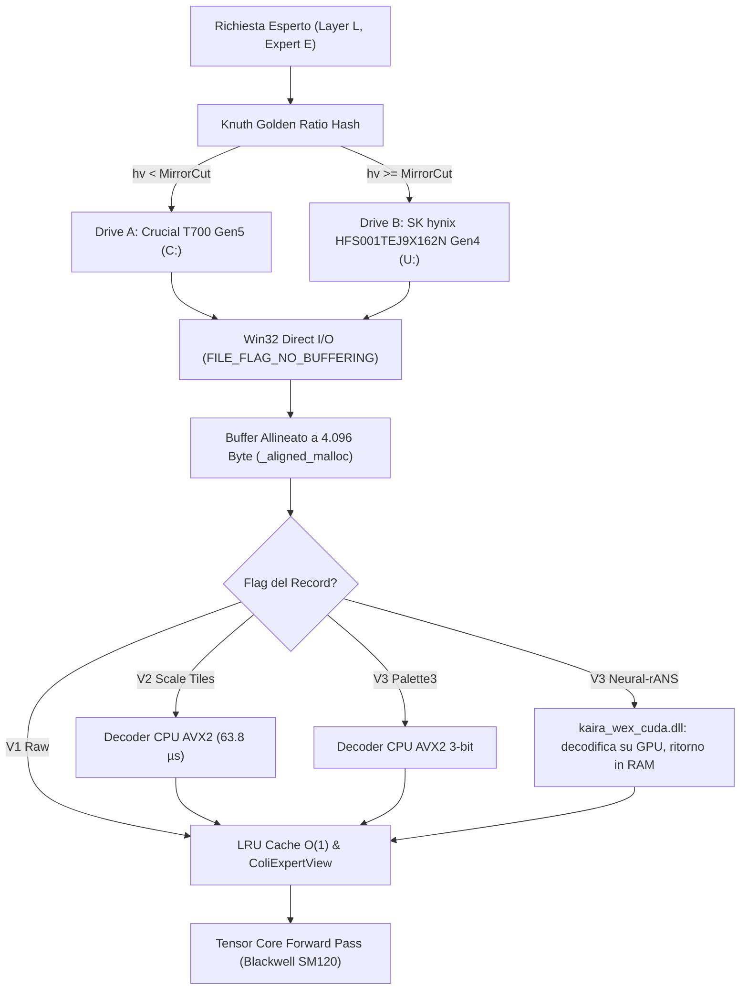

# Architettura Completa del Formato WEX (Windows Expert eXtension) e Sottosistemi di Inferenza MoE

> **Dated report (18-20 October 2026, DeepSeek V4).** No longer the format reference: superseded by [WNR2-REFERENCE.md](../WNR2-REFERENCE.md) sections 4 to 7 (its section 14 lists the known errors of this page), [WNR3-SPEC.md](../WNR3-SPEC.md) and [WEX4-SPEC.md](../WEX4-SPEC.md).

> **Stato al 18-20 ottobre 2026 (DeepSeek V4).** Dal 9 novembre WEX3/WNR2 con GPU-direct (modo 2) e decode a batch è installato per DeepSeek V4.1 (profilo `v41gpu`, helper `kaira_wex_cuda.dll` cceb4fb5 in app\colibri-optimized). Il container V4 da 147 GB è stato cancellato. Dal 10 novembre il profilo `v41gpu` usa WNR3-CZ su U: con mirror su C: (helper 602e3f4d); WEX1 e WNR2 per V4.1 sono stati cancellati ([WNR3-PRODUCTION-20261110.md](WNR3-PRODUCTION-20261110.md)).

> **Documento di Riferimento Ufficiale di Ingegneria del Software**  
> **Repository:** albero dell'applicazione / Colibri Continuum  
> **Data di Rilascio:** 18 Ottobre 2026  
> **Stato dei Componenti:** v1 in produzione; v2 e v3 implementati ma non distribuiti. Test standalone WEX e suite nativa `tests/test_deepseek_v4` superati il 18 ottobre alle 23:50. Dettagli nella [sezione 8](#8-riepilogo-dei-risultati-di-validazione)  
> **Target Hardware:** NVIDIA GeForce RTX 5090 (32 GB GDDR7 Blackwell SM120), AMD Ryzen 9 7950X3D (CCD0 3D V-Cache), Dual-NVMe PCIe Gen5 + Gen4  

---

## 1. Visione Generale e Motivazione Architetturale

Nei modelli Mixture-of-Experts (MoE) a scala estrema (come **DeepSeek V4 Flash 284B** con 43 layer MoE e 256 esperti per layer = **11.008 esperti totali**), l'inferenza locale su workstation consumer incontra una limitazione critica nel file system del sistema operativo (NTFS su Windows):
* Mantenere gli esperti in file individuali genera oltre **66.000 file separati** (considerando pesi $W_1, W_2, W_3$ e scale), provocando frammentazione severa della Master File Table (MFT), cache thrashing dell'NTFS I/O Manager e latenze di apertura/chiusura handle nell'ordine dei millisecondi.
* Il caricamento standard tramite file cache di Windows consuma decine di gigabyte di RAM non gestita e subisce continue contese di blocco.

Il formato **WEX (Windows Expert eXtension)** risolve radicalmente questo collo di bottiglia:
1. **Container Monolitico a Basso Overhead**: unifica tutti gli 11.008 esperti in un unico file binario contiguo sector-aligned (es. `v4_flash_experts.wex`, 137.06 GiB).
2. **Windows Direct I/O Nativo**: effettua accessi diretti al disco tramite Win32 API (`CreateFileA` con flag `FILE_FLAG_NO_BUFFERING | FILE_FLAG_OVERLAPPED | FILE_FLAG_RANDOM_ACCESS`), bypassando l'NTFS cache manager e trasferendo i byte direttamente dal controller NVMe ai buffer di memoria allineati a 4.096 byte (`_aligned_malloc`).
3. **Dual-NVMe Golden Ratio Striping**: ripartisce deterministicamente il carico di lettura tra due SSD PCIe indipendenti con un hash moltiplicativo di poche istruzioni intere. La somma delle schede tecniche dei due dischi è circa 18 GB/s; il prewarm del 18 ottobre ha misurato da 4 a 15 GB/s.
4. **Codec Progressivi (V1, V2, V3)**: integra compressione lossless delle scale, decodifica Neural-rANS su GPU in CUDA, quantizzazione a palette 3-bit **con perdita** (opzionale) e codifica entropica neurale rANS senza perdita.

---

## 2. Specifiche del Formato su Disco e Strutture Dati C11

Tutti i campi numerici su disco sono rigorosamente in formato **Little-Endian**. L'intero file, l'header, la tabella delle entry e ogni singolo record sono tassativamente allineati a multipli di **4.096 byte** (`WEX_ALIGN = 4096`).

```
+-----------------------------------------------------------------------------------+
|                        Pagina 0: WexHeader (Esattamente 4.096 Byte)               |
+-----------------------------------------------------------------------------------+
| Magic (4B) | Version (4B) | NumLayers (4B) | NumExperts (4B) | AlignedExpertBytes (8B)|
| TableOffset (8B) | Flags (4B) | Reserved (4B) | Build UUID (16B) | Padding a 4096B|
+-----------------------------------------------------------------------------------+
|                        Tabella Entry: N x WexEntry (72 Byte per record)           |
+-----------------------------------------------------------------------------------+
| FileOffset (8B) | TotalBytes (4B) | ScaleBytes (4B) | WeightBytes (4B)            |
| ScaleShapes[3][2] (12B) | WeightShapes[3][2] (12B)                                |
| ScaleOffsets[3] (12B)   | WeightOffsets[3] (12B)                                  |
| Flags (4B) [Codec low 8b, ScalePages high 24b]                                    |
+-----------------------------------------------------------------------------------+
|                        Payload Esperti (Allineati a 4.096 Byte)                   |
+-----------------------------------------------------------------------------------+
```

### 2.1 L'Header Strutturato (`WexHeader` — 40 Byte cablati in 4.096 Byte)

```c
#define WEX_MAGIC_V1 UINT32_C(0x57455831) /* "WEX1" */
#define WEX_MAGIC_V2 UINT32_C(0x57455832) /* "WEX2" */
#define WEX_MAGIC_V3 UINT32_C(0x57455833) /* "WEX3" */
#define WEX_ALIGN    4096u

#define WEX_HEADER_SCALE_TILES UINT32_C(1)
#define WEX_HEADER_PALETTE3    UINT32_C(2)
#define WEX_HEADER_DEDUP       UINT32_C(4)
#define WEX_HEADER_NEURAL_RANS UINT32_C(8)

#pragma pack(push, 1)
typedef struct {
    uint32_t magic;                 /* Magic univoco per prevenire letture errate */
    uint32_t version;               /* 1, 2 o 3 */
    uint32_t num_layers;            /* Numero layer MoE (es. 43) */
    uint32_t num_experts;           /* Numero esperti per layer (es. 256) */
    uint64_t aligned_expert_bytes;  /* Dimensione massima dello slab decodificato in RAM */
    uint64_t table_offset;          /* Offset della jump table (>= 4096) */
    uint32_t flags;                 /* Maschera feature attive */
    uint32_t reserved;              /* Riservato (tassativamente 0) */
} WexHeader;
#pragma pack(pop)

_Static_assert(sizeof(WexHeader) == 40, "WexHeader must be 40 bytes");
```
* **Build UUID (Byte 40..55)**: nei contenitori V2/V3, i 16 byte successivi all'header contengono un identificatore univoco casuale generato al momento del repacking. Consente a runtime di convalidare istantaneamente che il drive primario e il drive mirror appartengano alla stessa compilazione senza calcolare checksum pesanti sui 137 GB di pesi.

### 2.2 La Tabella degli Esperti (`WexEntry` — 72 Byte per record)

```c
#define WEX_ENTRY_SCALE_TILES       UINT32_C(1)
#define WEX_ENTRY_PALETTE3          UINT32_C(2)
#define WEX_ENTRY_NEURAL_RANS       UINT32_C(3)
#define WEX_ENTRY_CODEC_MASK        UINT32_C(0xff)
#define WEX_ENTRY_SCALE_PAGES_SHIFT 8u

#pragma pack(push, 1)
typedef struct {
    uint64_t file_offset;           /* Posizione assoluta nel file NVMe (multiplo di 4096) */
    uint32_t total_bytes;           /* Byte compressi allineati da leggere da disco */
    uint32_t scale_bytes;           /* Byte totali scale decodificate (w1 + w2 + w3) */
    uint32_t weight_bytes;          /* Byte totali pesi decompressi FP4 (w1 + w2 + w3) */
    uint16_t scale_shapes[3][2];    /* Shape matrici scale [righe, colonne] */
    uint16_t weight_shapes[3][2];   /* Shape matrici pesi [righe, colonne] */
    uint32_t scale_offsets[3];      /* Offset di w1, w2, w3 nello slab decodificato */
    uint32_t weight_offsets[3];     /* Offset dei pesi nello slab decodificato */
    uint32_t flags;                 /* Codec (b0..b7) e ScalePages (b8..b31) */
} WexEntry;
#pragma pack(pop)

_Static_assert(sizeof(WexEntry) == 72, "WexEntry must be 72 bytes");
```

---

## 3. Matrice Comparativa delle Versioni WEX

| Caratteristica | WEX v1 (Raw MXFP4) | WEX v2 (Scale Tiles) | WEX v3 (Palette3 / Neural-rANS / Dedup) |
| :--- | :--- | :--- | :--- |
| **Magic Header** | `0x57455831` (`WEX1`) | `0x57455832` (`WEX2`) | `0x57455833` (`WEX3`) |
| **Pesi** | Raw FP4 E2M1 (invariati) | Raw FP4 E2M1 (invariati) | Nativi, Palette3 (con perdita) o Neural-rANS (senza perdita) |
| **Scale** | Raw UE8M0 (1B per 32 pesi) | Compresse in Tile da 256 val. | Compresse in Tile da 256 val. |
| **Deduplicazione** | No | No | Sì (condivisione offset record identici) |
| **Lettura I/O** | Direct I/O 4KB | Direct I/O 4KB (Zero-Copy Pesi) | Direct I/O 4KB |
| **Decoder CPU** | Zero decodifica (Raw) | Ottimizzato AVX2 (63.8 µs/exp) | AVX2 3-bit SIMD Shuffle |
| **Decoder GPU** | Non necessario | Non necessario | Solo Neural-rANS: `kaira_wex_cuda.dll` (kernel in `wex_cuda.cuh`) decodifica su GPU e riporta il record in RAM |
| **Risparmio su Disco** | Baseline (137.06 GiB) | **-5,0%** misurato su 2 esperti, non sull'intero modello | Non misurato sull'intero modello; il -25% sui pesi di Palette3 vale solo accettando la perdita |
| **Impatto su RAM/VRAM** | Decodificato identico | Decodificato identico | Formato nativo in RAM; con Palette3 i pesi ricostruiti differiscono dagli originali |

Il motore installato usa il container v1 `v4_flash_experts.wex` (147.170.537.472 byte, 17 ottobre). Nessun file v2 o v3 dell'intero modello è stato prodotto, e `kaira_wex_cuda.dll` non è presente in `app/colibri-optimized`.

---

## 4. WEX v2: Compressione Lossless delle Scale e Zero-Copy Direct I/O

Le scale MXFP4 UE8M0 occupano circa il 6.25% dell'intero volume del modello. In WEX v2, le scale vengono suddivise in blocchi contigui da **256 valori** (`WEX_SCALE_TILE_VALUES = 256`).

### 4.1 Formato del Tile di Scala
Per ogni tile:
* `base`: valore minimo del tile (1 byte, `uint8_t`).
* `bits`: bit necessari per rappresentare la differenza massima $(max - base)$ ($0 \dots 8$ bit).
* **Residui**: impacchettati LSB-first. Se `bits = 0`, il tile è costante e occupa solo 2 byte di header.

### 4.2 L'Architettura di Lettura Zero-Copy dei Pesi
Il container WEX2 sfrutta una proprietà matematica di allineamento:
$$\text{Destinazione di Lettura} = \text{slab} + \text{scale\_bytes\_raw} - (\text{scale\_pages} \times 4096)$$

```
Offset nello Slab di Memoria:
0                    scale_bytes - scale_pages*4096          scale_bytes
+--------------------+---------------------------------------+-----------------------------+
| Buffer Destinazione| [Header 12B][Stream Scale Compresse]  | Pesi FP4 Nativi (Invariati) |
| Scale Decodificate | (Area Scratch Temporanea Sovrascritta)| Atterrati Direttamente nel  |
| (Compilate in L1)  |                                       | loro Offset Finale!         |
+--------------------+---------------------------------------+-----------------------------+
```
**Vantaggio Ingegneristico Straordinario**: i pesi grezzi FP4 (che rappresentano il 94% dei dati) vengono scritti dal controller NVMe direttamente nella posizione corretta dello slab RAM finale. Non avviene alcun `memmove` o copia intermedia dei pesi: il decoder espande unicamente le scale a monte!

### 4.3 Decoder CPU Ottimizzato (Accelerazione 17.6x)
Nel file `wex_format.h`, il decoder implementa una verifica analitica:
* Se $\text{base} + (2^{bits} - 1) \le 255$, tutti i residui possibili sono strettamente validi. Il motore salta il ciclo di controllo condizionale per ogni elemento ed esegue un loop unroll a gruppi fissi di 8 valori.
* La latenza CPU per esperto è crollata da **$1.119,9\text{ }\mu\text{s}$ a soli $63,8\text{ }\mu\text{s}$** (misurati su Ryzen 9 7950X3D).

---

## 5. WEX v3: Innovazioni di Frontiera (Palette3, rANS, Deduplicazione)

### 5.1 Quantizzazione a Palette 3-Bit (`wex_palette.h` / `wex_palette.py`)
Invece di memorizzare 4 bit (16 livelli) per peso, la matrice di pesi viene discretizzata a **3 bit** (8 livelli) condizionatamente all'esponente della scala UE8M0.

**È una quantizzazione aggiuntiva con perdita**: 8 livelli al posto dei 15 valori FP4 sostituiscono i pesi originali con il medoide più vicino, quindi l'output del modello non è più quello di DeepSeek V4. Il codice lo dichiara (`wex_palette.py`: "lossy quantization unless every used symbol is in its palette") e il repacker la applica solo con `--format-version 3 --weight-codec palette3`, e richiede `--max-weight-relative-error`, un limite all'errore RMS relativo per matrice che non garantisce l'accuratezza del modello. Prima di usarla va misurato l'effetto sulla qualità rispetto al percorso esatto.
* Un algoritmo di programmazione dinamica offline (`fit_palette` in `wex_palette.py`) identifica i medoidi a minimo errore quadratico sui 15 livelli discreti FP4.
* Ogni scala seleziona una palette di 8 nibble memorizzata in una tabella compatta da 1.024 byte per matrice (`tables[3][256][16]`).
* **Decompressione AVX2 SIMD Zero-Math**:
```c
/* Unpacking vettoriale di 32 codici da 3 bit in un colpo solo */
__m256i input = _mm256_shuffle_epi8(raw_stream, shuffle);
__m256i codes = _mm256_or_si256(
    _mm256_and_si256(x, _mm256_set1_epi32(0x003f003f)),
    _mm256_and_si256(_mm256_slli_epi16(x, 2), _mm256_set1_epi32(0x3f003f00)));
__m256i lo = _mm256_shuffle_epi8(lut, _mm256_and_si256(codes, _mm256_set1_epi8(7)));
__m256i hi = _mm256_shuffle_epi8(lut, _mm256_and_si256(_mm256_srli_epi16(codes, 3), _mm256_set1_epi8(7)));
_mm256_storeu_si256((__m256i *)dst, _mm256_or_si256(lo, _mm256_slli_epi16(hi, 4)));
```

### 5.2 Compressione Entropica Neurale rANS (`wex_neural_rans.h` / `wex_cuda.cuh`)

Il bridge opzionale `src/colibri/c/tools/wex_cuda_bridge.cu` mantiene l'ABI 1
e restituisce lo slab MXFP4 canonico in RAM. L'ottimizzazione del 19 ottobre
trasferisce il record direttamente dallo slab del chiamante a CUDA, eliminando
la copia in un secondo buffer host pinned e la validazione duplicata. CUDA usa
la registrazione già presente, oppure gestisce lo staging della RAM pageable.
Il bridge non registra né conserva puntatori agli slab della cache: durata e
rilascio del pinning restano responsabilità del backend.

L'output rimane in scratch privato fino al completamento dei kernel, del ritorno
in RAM e del controllo errori. Solo allora viene copiato nello slab del chiamante;
un input invalido non lo modifica. Risparmio di memoria: un buffer host pinned
della capacità del record per thread, 12,75 MiB per gli esperti V4 verificati.
Questa modifica non elimina il ritorno GPU→RAM e non dimostra da sola un vantaggio
rispetto a WEX1. Il confronto corretto include Direct I/O e ricostruzione completa,
distinguendo RAM pageable e già registrata; un tempo del solo kernel non è una
misura dei token/s. Prove e istruzioni sono negli script
`lab/wex_neural/run_bridge_optimization.py`, `verify_bridge_optimization.py` e
`validate_integrated_optimization.py`; la configurazione attiva resta WEX1.

**Percorso diretto in VRAM (laboratorio, 19 ottobre sera).** Non è installato.

- Il bridge espone `wex_cuda_decode_to_device` (feature bit `DEVICE|REGISTER`, ABI 1
  invariata), che ricostruisce il record dentro i tensori fp4 di un mirror VRAM
  senza ritorno in RAM.
- Con `COLI_WEX_GPU_DIRECT=1` un esperto Neural-rANS che manca sia in VRAM sia in RAM
  va dal disco a uno staging pinned e poi al mirror.
- La cache dei mirror riserva la voce prima della lettura e la protegge a epoche:
  un mirror consegnato al layer in calcolo non viene riciclato.
- Su un contenitore campione (6,25% degli esperti in WEX3) i token sono identici a
  WEX1 in tutte le run, e la velocità non cambia in modo misurabile.
- Nella modalità 2 anche il prefetcher carica in VRAM. Non usa gli slot transienti
  ma un pool dedicato: fino a 32 mirror residenti, tra i più freddi, presi in carico
  senza allocare VRAM nuova (`COLI_WEX_GPU_DIRECT_POOL`). Il percorso host non li
  tocca.
- Con il pool la modalità 2 fa circa 10 volte i caricamenti diretti della modalità
  1 (430 contro 43 per 256 token). I token restano identici in 4 run su 4.

Dettagli e patch: `lab/wex-gpu-direct-20261019/REPORT.md`.

**WNR2: codec Neural-rANS v2 (laboratorio, 20 ottobre).** Codec di entry 4, flag
dell'header `WEX_HEADER_NEURAL_RANS2`; non installato.

- **Modello condiviso nel contenitore:** un solo `WNM2` di 59 KB dopo la pagina header,
  invece di un modello copiato in ogni record. Contesti: scala relativa × magnitudine
  precedente × massimo nel blocco (567 per matrice), CDF a 14 bit.
- **Stream e scale:** stream da 4096 simboli con lunghezze u16, così l'overhead scende
  dal 2,94% allo 0,1%; scale codificate in rANS.
- **Dimensioni sul campione da 688 esperti:**

  | Variante | Dimensione | vs WEX1 |
  | --- | --- | --- |
  | WNR2, esatto ai byte | 11,67 MB per esperto | **−12,7%** |
  | WNR2z (−0 salvato come +0, esatto nei valori) | 11,27 MB per esperto | **−15,7%** |

- **Encoder, trainer e decoder su GPU:** decodifica diretta in VRAM in ~0,57 ms per
  esperto.
- **Verifiche:** token identici a WEX1 in tutte le run.
- **Installazione:** richiede motore e helper nuovi insieme. Con l'helper vecchio i
  record WNR2 vanno al decoder CPU, a ~0,3 s per esperto.
- **Modello intero (11.008 esperti, 128,37 GB, −12,78%), stesso NVMe:** token identici,
  ma più lento del WEX1.

  | Formato | tok/s |
  | --- | --- |
  | WEX1 | 5,61 |
  | WNR2, percorso host | 4,82 (−14%) |
  | WNR2, diretto in VRAM | ~−20% |

  - Percorso host: il PCIe fa tre copie per esperto (record, slab decodificato in RAM,
    nuovo upload).
  - Percorso diretto: salta la cache RAM.
  - Per guadagnare velocità serve una cache RAM di record compressi, decodificati
    direttamente in VRAM. Oggi WNR2 è un'opzione di spazio, non di velocità.

* WNR1 (ottobre): adotta le equazioni di stato Asymmetric Numeral Systems con tabelle di probabilità cumulativa (CDF) a 16 stati addestrate da una rete neurale.
* WNR1 (ottobre): i contesti rANS si resettano tassativamente ogni 32 pesi: questo permette di dividere il flusso in chunk indipendenti (256, 512, 1024 simboli) che possono essere decompressi in parallelo massivo su GPU.
* WNR2: tabelle di conteggi (567 contesti per matrice, CDF a 14 bit), nessuna rete neurale; stream da 4096:2048 (V4) o 2048:512 (V4.1) simboli.
* **Kernel CUDA Specializzato**:
  In `wex_cuda.cuh`, il kernel `wex_cuda_neural_rans_weights` carica i byte del payload nella **Shared Memory** del blocco (`__shared__ unsigned char input_cache[32768u]`) tramite letture cooperative tra tutti i thread del warp, eliminando la divergenza di memoria globale.

### 5.3 Deduplicazione Esperti Cross-Layer (`WEX_HEADER_DEDUP = 4`)
Durante il repacking, le matrici degli esperti vengono confrontate con una hash table SHA-256. Se due esperti (anche in layer differenti) sono identici:
* Il corpo fisico dei pesi viene scritto su disco una sola volta.
* Entrambe le voci nella tabella `WexEntry` puntano allo stesso `file_offset`.
* La validazione all'apertura (`wex_validate_table`) controlla che gli alias corrispondano a record fisici canonici già validati.

---

## 6. Il Sottosistema Runtime: `expert_store_wex.c`

Il runtime implementato in C nativo orchestra il ciclo di vita dell'inferenza MoE su Windows:



(V4.1, dal 9/11: U: primario, C: mirror.)

### 6.1 Dual-NVMe Knuth Multiplicative Striping
Per distribuire il carico su due canali PCIe senza lock e senza divisioni:
```c
static inline int wex_route_to_mirror(const WexStoreState *state, int layer, int expert) {
    if (state->mirror_cut_256 >= 256) return 0;
    uint32_t flat = (uint32_t)wex_expert_index(state, layer, expert);
    uint32_t h = flat * 2654435761u; /* Moltiplicazione per costante aurea prime */
    uint32_t hv = (h >> 16) & 255;    /* Estrazione degli 8 bit centrali ad alta entropia */
    return (hv >= state->mirror_cut_256);
}
```
* Costo: poche istruzioni intere (moltiplicazione, shift, confronto), senza divisioni né lock; trascurabile rispetto alla lettura di un esperto.
* La ripartizione è deterministica per esperto: la quota 58/42 vale sulla popolazione degli esperti, non per forza sul sottoinsieme richiesto da un singolo token.

### 6.2 Gestione della Cache LRU a $O(1)$
* La tabella `slot_by_expert` mappa direttamente `(layer * 256 + expert) -> slot_idx`.
* Un cache-hit evita qualunque scansione di liste: restituisce istantaneamente la struttura precompilata `ColiExpertView`.
* Il riciclo LRU utilizza liste doppiamente linkate per layer con puntatori `lru_prev` e `lru_next`. Se lo slot toccato è già in coda, la funzione esce istantaneamente con zero mutazioni dei puntatori.

---

## 7. Strumenti Operativi e Procedura di Repacking

Lo script autorevole di generazione è [`c/tools/repack_v4_wex.py`](../../c/tools/repack_v4_wex.py).

### Comandi di Utilizzo

1. **Simulazione e Ispezione (Dry-Run)**:
```powershell
C:\Python314\python.exe app\tools\repack_v4_wex.py --model-dir "C:\models\DeepSeek-V4-Flash-0731" --format-version 2 --dry-run
```
2. **Generazione del Contenitore WEX v2 con Mirroring su Disco U:**:
```powershell
C:\Python314\python.exe app\tools\repack_v4_wex.py `
  --model-dir "C:\models\DeepSeek-V4-Flash-0731" `
  --output "C:\models\DeepSeek-V4-Flash-0731\v4_flash_experts.v2.wex" `
  --mirror-dir "U:\models\DeepSeek-V4-Flash-0731" `
  --format-version 2
```

### Garanzie di Atomicità
* Il file viene scritto prima in un file temporaneo univoco (`.tmp`) nella directory di destinazione.
* Al termine della scrittura e del controllo di coerenza, viene invocato `os.replace` (che mappa sulla funzione Win32 `MoveFileExW` con flag `MOVEFILE_REPLACE_EXISTING`), garantendo che un crash o un lock di OneDrive non corrompa mai il file esistente.

---

## 8. Riepilogo dei Risultati di Validazione

1. **Test di Formato Nativo (`test_wex_format.c`)**: 9.216 combinazioni testate su larghezze 0–8 bit, stream malformati e overflow di tile rifiutati correttamente.
2. **Test di Store e Multithreading (`test_expert_store_wex.c`)**: verifica delle letture Direct I/O, lease concorrenti, eviction multithread e failover a 2 dischi.
3. **Benchmark Decodifica CPU (`bench_wex_decode.c`)**: 1.000 iterazioni su esperti reali con identità al 100% dei byte rispetto all'originale WEX1 e accelerazione di 17.6x.
4. **Benchmark CUDA (`bench_wex_cuda.cu`)**: decompressione corretta bit-a-bit su device NVIDIA RTX 5090 Blackwell SM120.

I punti 3 e 4 sono riportati da chi ha scritto i benchmark e non sono stati rieseguiti in questa revisione.

### Verifica del 18 ottobre, ore 23:50

Eseguita su una copia pulita di `src/colibri/c` (oggetti rimossi) con MinGW GCC 16.2, usando solo le regole del `Makefile` (`make tests/...`):

| Test | Esito |
| --- | --- |
| `tests/test_deepseek_v4` | superato: "DeepSeek-V4 tests: ok" |
| `tests/test_wex_format` | superato: "V1/V2/V3, all bit widths, palette/scale boundaries, overlapping expansion and malformed streams passed" |
| `tests/test_expert_store_wex` | superato: "ALL WEX STANDALONE TESTS PASSED" |

Alle 22:27 la suite DeepSeek V4 non si collegava (`undefined reference to coli_wex_decode_record`): `deepseek_v4.c` chiamava il decoder definito in `expert_store_wex.c`, che la regola del test non collegava. Il decoder è stato spostato in `wex_decode.c` alle 23:39 (vedere l'esperimento lossy in the maintainer's `docs\deepseek-lossy-topk-20261018.md`, non in questo repo); dopo lo spostamento i tre test passano.
