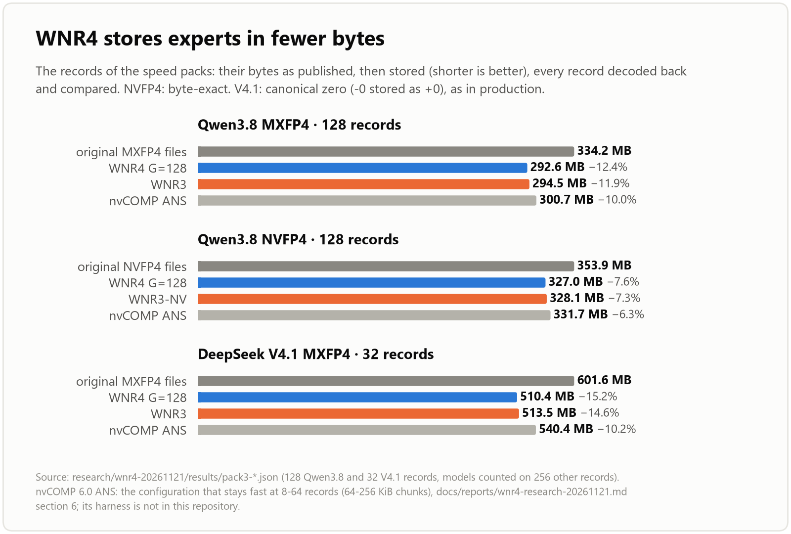
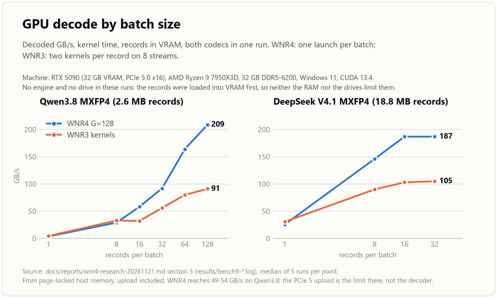
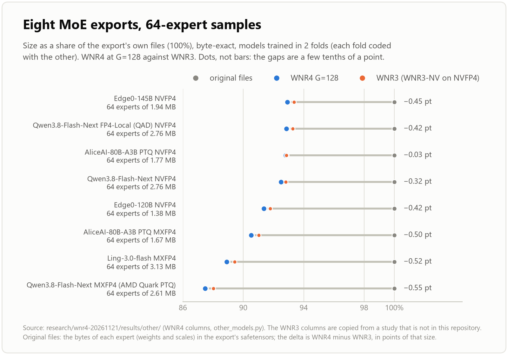

# WNR4: research, design and measurements (2026-11-21)

> **Dated report (2026-11-21).** Research on a successor of WNR3; nothing here is in production. The format draft: [WNR4-SPEC.md](../WNR4-SPEC.md). What runs today: [STATUS.md](../../STATUS.md). This WNR4 is not the "WNR4 record" of [WEX4-SPEC.md](../WEX4-SPEC.md) section 12.2 (three changes to WNR3's stream skeleton); it goes further, see the [glossary](../GLOSSARY.md).

**Question.** Can a successor of WNR3 store MXFP4/NVFP4 routed experts in fewer bytes than WNR3 **and** decode on the GPU fast enough (target >= 40 GB/s of decoded slab on the RTX 5090, batched, straight into VRAM) for compressed experts to beat re-reading RAW records from NVMe?

**Answer in short.**
- Ratio: yes, by 0.3-0.6 points of raw on every container measured, on 2048 held-out records each, every record decoded back and compared (Qwen3.8 byte-exact, V4.1 in the canonical-zero domain of its production records): Qwen3.8 MXFP4 **0.8753 vs WNR3 0.8809**, Qwen3.8 NVFP4 byte-exact **0.9238 vs WNR3-NV 0.9271**, DeepSeek V4.1 MXFP4 **0.8488 vs WNR3 0.8539** (G = 128; G = 256 a further -0.03 to -0.04).
- Where the gain comes from: framing (lengths, per-stream flush and hash) is gone, the last 4 nibbles of every lane ride in its initial state, NVFP4 scales are coded against the row above, and a position bucket for the last 4 nibbles of a block. The weight model itself is at its floor: no context tried (per-layer tables, column profiles shared across experts, block-maximum-first, finer scale classes, more training data) gains more than 0.02% held out.
- Speed: yes. The CUDA decoder (one warp per tile, 32 rANS lanes sharing a 16-bit word stream, one launch per batch, output straight into the destination slots) decodes **up to 206 GB/s** of slab on the RTX 5090 (Qwen3.8 MXFP4, kernel only), 140 GB/s on NVFP4 and 188 GB/s on V4.1, against 90 GB/s for WNR3's kernels on the same records and no GPU decoder at all for WNR3-NV. From page-locked host memory, upload included, it reaches 49-54 GB/s, which is the PCIe 5 upload rate: decode is no longer the bottleneck. The >= 40 GB/s target holds from a batch of 8 records (G = 32) or 16-32 records (G = 128).
- Trade-off: G (cells per lane per tile) sets ratio vs latency; G = 32 gives 0.19 ms per lone Qwen3.8 record and 104-204 GB/s at batch 8-32 for +0.2 points of ratio (still 0.4 below WNR3).

<picture>
  <source media="(prefers-color-scheme: dark)" srcset="../../research/wnr4-20261121/charts/wnr4-ratio-dark.png">
  
</picture>

<picture>
  <source media="(prefers-color-scheme: dark)" srcset="../../research/wnr4-20261121/charts/wnr4-gpu-dark.png">
  
</picture>

<picture>
  <source media="(prefers-color-scheme: dark)" srcset="../../research/wnr4-20261121/charts/wnr4-models-dark.png">
  
</picture>

Everything here is measured on this machine (RTX 5090, Ryzen 9 7950X3D, 32 GB) unless marked. Literature: [research/wnr4-20261121/literature.md](../../research/wnr4-20261121/literature.md). Format: [WNR4-SPEC.md](../WNR4-SPEC.md). Code and raw results: [research/wnr4-20261121](../../research/wnr4-20261121/README.md).

## 1. Starting point

- WNR3 (codec 5): WNR2's rANS skeleton (32-bit state, L = 2^23, byte renormalisation, 14-bit tables) with one independent stream per 2048 nibbles (1 KB) and per 512 scales, a 23-bit hash in each stream's initial state, u16 lengths; model = class of the block scale vs the rule-g anchor x previous magnitude x running maximum (567 contexts per matrix), ceil form and canonical zero. The GPU kernel runs one thread per stream (scales kernel, then weights kernel).
- The research of 2026-11-17 (research/wnr3-improve-20261117) bounded what is left on V4.1: 0.69% of raw to the best adaptive code found, of which 0.585 points are framing and only 0.11-0.13 model; it proposed a 32-lane interleaved skeleton ("WNX") at -0.39..-0.42%, CPU only.
- Speed: the GPU WNR3 kernels decode a batch of 16 V4.1 records in ~0.37 ms each (≈ 51 GB/s kernel time, WNR3-VERIFY), but the engine sees ~1.9 GB/s on Qwen3.8 because records are small (2.6 MB, ~2,500 streams, 2048-step chains), launches are per record in two kernels, and the qwen38 store decodes back to host memory. An engine-side analysis puts break-even at >= 40 GB/s batched.

## 2. Where the redundancy is (held-out measurements)

Context study (256 training records, other records as the test set, cross-entropy under 14-bit quantized tables, fraction of raw). Sources: `stats/ctx3.py` (and `stats/ctx2.py` for run 1, in-sample), whose console output is copied in [results/ctx3-console.txt](../../research/wnr4-20261121/results/ctx3-console.txt) (run numbers below refer to it; the script grew between runs, so each column quotes one run where it can), and `stats/run_stats.py` ([results/stats-q38mx.log](../../research/wnr4-20261121/results/stats-q38mx.log), 2048 test records; marked "stats"). The test sets differ, so the same model can differ in the fifth digit between the two (WNR3 contexts on MX: 0.86691 in ctx3, 0.86699 in stats).

| model of the weight nibbles | Qwen3.8 MX (CZ), run 3 | Qwen3.8 NV (byte-exact), run 4 |
|---|---:|---:|
| WNR3 contexts (class, previous, running max) | 0.86691 | 0.86690 |
| class only (MX, stats) / class + position (NV) | 0.86793 | 0.86813 |
| + position in block (32 or 16 buckets) | 0.86604 | 0.86556 |
| + last-4-positions bucket (5 buckets) | - (in the codec: -0.06 points, section 4) | 0.86598 |
| per-layer tables / 8 layer groups | 0.86688 / 0.86684 | 0.86714 / 0.86691 |
| block maximum coded first | worse (+0.0018, stats) | worse (+0.0003 in-sample, run 1) |
| finer scale classes (R + 4, R + 8), run 8 | - | 0.86673 / 0.86672 |

| model of the scales | Qwen3.8 MX, run 3 | Qwen3.8 NV, run 5 |
|---|---:|---:|
| order 0 | 0.00730 | 0.06527 |
| up (row above) | 0.00730 (stats) | 0.05811 |
| up + up-left/up-right deltas | - | 0.05605 |
| left neighbour (WNR3-NV) | 0.00727 | 0.05805 |
| left + up (full table) | 0.00726 | 0.05611 |
| left + delta from up + up-left delta | - | 0.05582 |
| run 8: up + deltas / delta from up, ctx (up/4, dul, dur) - **WNR4** | - | 0.05618 / 0.05620 |

The contexts that use the left neighbour are not open to WNR4: its phase 1 decodes a scale row across the lanes, so the left neighbour is decoded by another lane in the same step. WNR4 takes the best context without it, the row above and its two diagonal neighbours, with a table of 4,160 contexts that costs 0.00002 of raw against the full table of the same neighbours (run 8).

Other checks (in-sample bounds, so upper bounds on any gain): per-record column classes 0.004-0.039 bit/w on gate/up before the cost of the table (net ~0); the same column profile taken from other experts of the layer 0.0002-0.015 bit/w; a layer-shared scale profile -0.01..-0.03 bit/scale. Cross-expert and cross-layer structure is ~0, as the 2026-11-17 study found.

Reading: MXFP4 scales are already cheap (UE8M0, ~1 bit/scale); NVFP4 E4M3 scales are 5.6-6.5% of raw and are the one place where a better context pays (-0.2 points). The nibbles are within ~0.1% of the best context found.

## 3. Design (DRAFT 0.1, see the spec)

- **Tile = one warp.** 32 rANS lanes (32-bit state, L = 2^16, 16-bit words, 14-bit tables, at most one word per symbol) share one word stream; renormalising lanes take the next words in lane order (`__ballot_sync` + `__popc`, DietGPU's scheme). Lane l owns cells c0 + l, c0 + 32 + l, ...; a cell = 32 nibbles (16 bytes) + its scale(s). G cells per lane per tile (G = 128: a tile is 4,096 cells, ~68 KB of slab).
- **Phase 1** decodes the tile's scales row-major across the lanes (NVFP4 contexts read the row above, decoded at an earlier step); **phase 2** decodes the cells with WNR3's contexts (+ the last-4 position bucket), so a lane walks its own block sequentially and the context stays exact. Output goes straight to the caller's per-matrix destinations (uint4 stores, coalesced).
- **Tail in the state:** lanes 2..31 start at L + their last 4 nibbles, which are therefore not coded (saves ~1.8 B per lane); lanes 0 and 1 start at L + the two halves of the tile's 32-bit hash.
- **Integrity:** 32-bit MurmurHash3 per tile over the coded cells (per lane, XOR-combined), exact word count, every lane's final state checked; CZ nibble 8 and ceil underflow refused. 12,000 random 1-3-bit mutations of synthetic records: all refused.
- **Model blob WNM4** carries the tables for one kind (MX 0.29 MB with position buckets, NV 6.95 MB because of the 4,160 scale contexts); no per-record tables.

## 4. Ratio on real records (2048 held-out records per container, all decoded back byte-exact)

Training: 256 records evenly spaced in (layer, expert) order; test: 2048 other records, the same number per layer, seeded (`measure.py`). WNR3 / WNR3-NV baselines are encoded by their own encoders with a model counted on the same 256 records ("same train"); for V4.1 the stored production records are also given. Stored bytes include the 4096-byte padding of every record.

| container (test records) | domain | WNR3 | WNR4 G = 32 | G = 64 | **G = 128** | G = 256 | WNR4 G128 vs WNR3 |
|---|---|---:|---:|---:|---:|---:|---:|
| Qwen3.8 MXFP4 (2048 of 24,576) | CZ (= byte-exact: the export has no -0) | 0.88087 | 0.87729 | 0.87595 | **0.87526** | 0.87494 | -0.56 points |
| Qwen3.8 NVFP4 (2048 of 24,576) | byte-exact | 0.92709 (WNR3-NV 8192:2048) | 0.92599 | 0.92454 | **0.92383** | 0.92349 | -0.33 points |
| DeepSeek V4.1 REAP-192 MXFP4 (2048 of 7,680) | CZ (the production domain) | 0.85390 (production records 0.85391) | - | 0.84948 | **0.84878** | 0.84844 | -0.51 points |
| Qwen3.8 NVFP4 (2048 of 24,576) | CZ | 0.90945 (WNR3-NV 8192:2048) | - | - | **0.90621** | - | -0.32 points |

Largest record (G = 128): Qwen3.8 MX 2,338,816 B, NV 2,580,480 B, V4.1 16,728,064 B; none kept raw. Every one of the 2048 records of every row was decoded by the reference decoder and compared with the expected slab (Z(source) under CZ): 0 failures.

How the gain splits (Qwen3.8 MX, 64-256 record checks, same model): new skeleton at G = 128 without the tail trick -0.43 points; tail in the state -0.07; last-4 position bucket -0.07 (pb 1 -> 5 on 2048 records: 0.87589 -> 0.87526). NVFP4: delta-from-above scale context -0.18, position bucket -0.09, skeleton and tail the rest. Container-level option not taken: 512-byte instead of 4096-byte record alignment would save another ~0.07 points on Qwen3.8's 2.3 MB records (~0.01 on V4.1).

### 4b. Other MoE models (64-expert samples)

The samples of the WNR3 study of 2026-11-21 (8 layers x 8 experts per model, fetched by HTTP range from the published checkpoints; Qwen3.8 from the local containers), coded with the same method as that study: models trained on the sample itself in 2 folds (each fold coded with the model of the other), byte-exact and canonical zero, every record decoded back and compared (0 failures), ratio = stored / raw padded to 4096 B. WNR3 numbers: that study's cross-validated results on the same experts (WNR3 at 2048:512 for MXFP4, WNR3-NV at 8192:2048 for NVFP4). That study is not in this repository: its WNR3 columns are copied here and in `results/other/summary.md`, and `other_models.py` computes the WNR4 columns only. Script: `research/wnr4-20261121/other_models.py`; results in `results/other/`.

| model (64-expert sample, 2-fold CV) | record | WNR3 byte-exact | WNR4 G128 | WNR4 G32 | WNR3 CZ | WNR4 CZ G128 | WNR4 CZ G32 |
|---|---:|---:|---:|---:|---:|---:|---:|
| Qwen3.8-Flash-Next MXFP4 (AMD Quark PTQ) | 2.61 MB | 0.8802 | 0.8747 | 0.8766 | 0.8802 | 0.8747 | 0.8766 |
| Ling-3.0-flash MXFP4 | 3.13 MB | 0.8942 | 0.8890 | 0.8911 | 0.8689 | 0.8637 | 0.8659 |
| AliceAI-80B-A3B PTQ MXFP4 | 1.67 MB | 0.9102 | 0.9052 | 0.9069 | 0.9102 | 0.9052 | 0.9069 |
| Qwen3.8-Flash-Next NVFP4 | 2.76 MB | 0.9282 | 0.9250 | 0.9273 | 0.9104 | 0.9073 | 0.9095 |
| Qwen3.8-Flash-Next FP4-Local (QAD) NVFP4 | 2.76 MB | 0.9327 | 0.9285 | 0.9309 | 0.9170 | 0.9128 | 0.9152 |
| AliceAI-80B-A3B PTQ NVFP4 | 1.77 MB | 0.9285 | 0.9282 | 0.9301 | 0.9134 | 0.9134 | 0.9152 |
| Edge0-120B NVFP4 | 1.38 MB | 0.9179 | 0.9137 | 0.9157 | 0.9179 | 0.9137 | 0.9157 |
| Edge0-145B NVFP4 | 1.94 MB | 0.9336 | 0.9291 | 0.9316 | 0.9183 | 0.9139 | 0.9163 |

- WNR4 at G = 128 is smaller on seven of the eight (by 0.5-0.55 points of raw on the MXFP4 models, 0.3-0.45 on the NVFP4 ones), and ties on AliceAI NVFP4 (-0.03 byte-exact, 0.00 CZ): small 1.77 MB records, where WNR3-NV's long 8192-nibble streams already have little framing and WNR4's tile states plus the 4096-byte padding weigh more. G = 32 is still smaller than WNR3 on the MXFP4 models and about equal on NVFP4.
- These models are trained on 32 experts per fold; WNR4's bigger tables (position buckets, the 4,160 NVFP4 scale contexts) are the more undertrained of the two, so a model counted on a full container should widen the gap a little (on Qwen3.8 MX the 2048-record run gives about the same gap as this sample, -0.56 against -0.55 points).
- QAT/QAD weights (FP4-Local) and NVFP4 in general leave less to gain for any context model; the ratio difference between codecs is small next to the difference between formats.

## 5. Decode speed

RTX 5090 (170 SMs), CUDA 13.4, sm_120. Records resident in VRAM unless noted; "kernel only" = CUDA events around the one launch of the batch, median of 5; decoded GB/s = slab bytes / time. Every bench run first decodes every record of its pack on the GPU and compares it with the expected bytes (all identical), and flips one payload bit per record (all refused). Final configuration: word window, symbol start/end by two row loads ("LD"), block size chosen from the batch's tile count (4, 8 or 16 warps), NVFP4 rows through L1 at 16 warps. Logs: `research/wnr4-20261121/results/bench8-*.log` (round of 2026-11-21 04:29, the G sweep) and `bench9-*.log` (05:21, after the review fixes, WNR3 measured in the same run); the earlier rounds are `bench3-*` and `bench6-*`. Between rounds the same binary moved by up to ~30% (WNR3's kernels: 90 GB/s in bench6, 62 in bench8, 91 in bench9; their per-record launches make them sensitive to host load), so compare numbers within one log.

**Kernel only, GB/s by batch size, default configuration** (b = records per launch; latency = one record alone):

| data (G, stored/raw) | b 1 | b 8 | b 16 | b 32 | b 64 | b 128 | latency, 1 record |
|---|---:|---:|---:|---:|---:|---:|---:|
| Qwen3.8 MX (32, 0.8774) | 14 | 104 | 160 | 204 | 205 | - | 0.19 ms |
| Qwen3.8 MX (64, 0.8762) | 7 | 55 | 103 | 159 | 205 | - | 0.37 ms |
| Qwen3.8 MX (128, 0.8755) | 4 | 28 | 55 | 91 | 157 | 206 | 0.75 ms |
| Qwen3.8 MX (256, 0.8752) | 2 | 14 | 29 | 48 | 92 | - | 1.44 ms |
| Qwen3.8 NV (32, 0.9262) | 11 | 88 | 138 | 138 | 149 | - | 0.25 ms |
| Qwen3.8 NV (64, 0.9246) | 6 | 47 | 81 | 132 | 139 | - | 0.47 ms |
| Qwen3.8 NV (128, 0.9239) | 3 | 24 | 47 | 78 | 135 | 140 | 0.90 ms |
| Qwen3.8 NV (256, 0.9235) | 2 | 12 | 24 | 41 | 79 | - | 1.79 ms |
| V4.1 MX (128, 0.8484) | 25 | 144 | 188 | 185 | - | - | 0.75 ms |
| same run (bench9): WNR4 Qwen3.8 MX (128) | 3.6 | 29 | 58 | 92 | 164 | 209 | |
| same run (bench9): WNR3 kernels, Qwen3.8 MX (2048:512, 0.8812) | 4.3 | 33 | 32 | 56 | 80 | 91 | |
| same run (bench9): WNR4 V4.1 (128) / WNR3 kernels V4.1 | 25.6 / 30.6 | 146 / 90 | 187 / 103 | 187 / 105 | - | - | |

This is the ratio vs speed trade-off: G sets both. A lane's chain is G x 33 (MX) or G x 34 (NV) dependent steps (~170 ns each now), so one record's latency is proportional to G, and a batch needs enough tiles (a Qwen3.8 record has 150 tiles at G = 32, 39 at G = 128) to fill 170 SMs. G = 32 costs 0.2 points of ratio against G = 128 and is still 0.4 points smaller than WNR3; at batch 8-16 it is 2.9-3.7x faster than G = 128 and about 4x faster than WNR3's kernels (bench8-q38mx-G32: 104 / 160 GB/s against 25 / 42 for WNR3 in the same log). For one record alone at G = 128, WNR3's kernels are slightly faster (4.3 vs 3.6 GB/s on Qwen3.8, 30.6 vs 25.6 on V4.1): a latency-bound caller should use G = 32 (0.19 ms per Qwen3.8 record).

What each step gave (Qwen3.8 MX, G = 128, batch 128, kernel only, same records): first version 61.2 GB/s; word window in registers instead of one global load per renormalisation 73.0; 16-warp blocks (one shared table copy for 16 tiles, <= 64 registers, 2 blocks per SM) 149.0; no `break` in the symbol loop (the compiler then drops the divergent-collective slow paths around every ballot/shuffle) and LD lookup 206. NVFP4 first version 25.6 GB/s (its 77 KB tables allowed one 4-warp block per SM, and an 8-step binary search in global memory per scale), with 16-warp blocks, rows through L1, the two-level scale table and the same symbol-loop changes 140 (5.5x).

Nsight Compute (enabled for this round), first launch of each pack (128 records, 4,992 tiles, 16 warps per block): MX 2.87 instructions per cycle (67% of issue slots), achieved occupancy 55% (limit: 64 registers and 41 KB of shared memory, 2 blocks per SM), top stall "waiting for shared memory / shuffle" (32% of the 9.3 cycles between issues), ~106 warp instructions per lockstep step of a warp (32 symbols, one per lane), i.e. ~3.3 per decoded symbol (2.15 G instructions for 128 records of 153,600 cells x 33 symbols); NV 2.14 IPC, top stall waiting for L1 loads of the rows and scale tables (56% of 13.3 cycles), L1 hit rate 96%. Next lever: fewer instructions per step (the comparison half of the 16-symbol search is ~25 of them) and register pressure for a third block per SM.

**End to end from page-locked host** (plan on the CPU + upload of the compressed records + decode, two streams so batch i+1 uploads while batch i decodes; error words read once at the end; no commit copy; whole pack): Qwen3.8 MX 49-54 GB/s decoded (43-47 GB/s of compressed bytes moved: the PCIe 5 x16 upload is the limit, not the decoder), NVFP4 41-51 GB/s, V4.1 48-60 GB/s. Like for like with WNR3's production helper (synchronous per batch, status read back each batch, plus a commit kernel that copies every slab again so destinations stay untouched on failure; WNR4 decodes straight into the destination and gives that guarantee up): WNR4's synchronous helper call 33.8 GB/s at batch 32 and 43.1 at 64 vs WNR3 28.3 at 32 on Qwen3.8 MX (bench9/helper9, same run); on V4.1 41.5 vs 42.9 at batch 8 and 45.0 vs 47.1 at 16, i.e. equal when synchronous; WNR4's asynchronous path (two batches in flight) 55.6 GB/s at 8. NVFP4 has no WNR3 GPU path.

**Helper DLL** (`wnr4/tools/wnr4_cuda_bridge.cu`, after the review fixes, helper9 logs): asynchronous API with two batches in flight (one stream per slot) 51.6 GB/s on Qwen3.8 MX at batch 32 (45.9 at 16), 49.6 on NVFP4, 55.6 on V4.1 at batch 8; synchronous call 43.1 GB/s at batch 64. Asserted by the test: only the corrupted record of a batch reports -1 and the others decode bit-exact; an unknown model reports 1, a wrong owner -1; four batches in flight are accepted, a fifth before any wait is refused (no verdict is ever dropped), waits out of order work, a stale ticket returns -1; destinations are cleared before every timed run, so the async path's output is checked on its own.

**CPU** (reference decoder, scalar with an AVX2 16-symbol search, OpenMP over tiles; `wnr4_decode_batch` spreads every tile of every record): 0.057-0.060 GB/s per thread (2.2x WNR3's reference decoder, 0.027), 0.71 GB/s with 16-32 threads on a batch of 64 Qwen3.8 MX records, 0.60 on NVFP4, 0.63 on V4.1 (Ryzen 9 7950X3D). Above the shipped WNR3 fast decoder's 0.15-0.5 GB/s, but a fallback, not a fast path: a SIMD lane-parallel decoder (8 lanes per AVX2 register) is the open item.

Not measured: an engine run (the helper is not wired into an engine); multi-GPU; other GPUs.

## 6. Baselines run on the same data

Both run on the same packs (128 Qwen3.8 MX, 128 Qwen3.8 NV, 32 V4.1 records), outside this repository: nvCOMP is a proprietary SDK, so its harness is not included; the numbers below are what its public C API gave on this machine (nvCOMP 6.0, CUDA 13 build).

**nvCOMP 6.0, low-level batched API** (ANS, Bitcomp, Cascaded, GDeflate, LZ4, Snappy, Zstd, Deflate; chunks of 64 KiB, 256 KiB or one per record; weights and scales coded apart or together; all 580 configurations decoded bit-exactly; no hardware decompression engine on the RTX 5090, nvCOMPDx not part of the installed package):

An engine decodes a miss batch of a few to a few dozen records, so the table compares nvCOMP configurations that stay fast at 8-64 records per call (weights and scales in 64 KiB or 256 KiB chunks). The configurations with the best whole-pack ratio code each record's weights as one ANS chunk; they are fast only when a whole pack (128 records, 32 for V4.1) is one call: at 8 Qwen3.8 records that configuration decodes at 24 GB/s of kernel time and 15.5 GB/s with the upload, below PCIe. Both kinds of point are listed.

WNR3 and WNR4 columns: the same packs (`results/pack3-*.json`; the 2048-record ratios of section 4 differ by at most 0.0004).

| pack | nvCOMP-ANS fast at 8-64 records (ratio) | best whole-pack ratio (one chunk per record; GB/s for the whole pack) | WNR3 / WNR3-NV | WNR4 G = 128 | WNR4 lead over the fast point |
|---|---:|---|---:|---:|---:|
| Qwen3.8 MX | 0.8997 | 0.8951 (351 GB/s) | 0.8812 | 0.8755 | 2.42 pt |
| Qwen3.8 NV | 0.9372 | 0.9328 (378 GB/s) | 0.9272 | 0.9239 | 1.33 pt |
| V4.1 MX | 0.8983-0.8985 | 0.8983 (552 GB/s) | 0.8536 | 0.8484 | ~5.0 pt |

(WNR3's lead over the same fast points: 1.85 / 1.00 / ~4.5 points of raw. WNR4 at G = 32 on a 64-record Qwen3.8 MX pack drawn the same way: 0.8774, 2.23 points below the fast point; 2.24 with the 2048-record ratio 0.87729.)

- nvCOMP's codecs are generic byte coders: on the packed FP4 bytes the best is 0.943 (Qwen3.8 MX), 0.987 (NV), 0.946 (V4.1); Bitcomp, Cascaded, LZ4 and Snappy store weights at 1.0 or more. Only the scales compress (ANS 0.12-0.13 on UE8M0, 0.49-0.51 on E4M3). LZ/Deflate-family decoders are 19-176 GB/s.
- **Speed is where nvCOMP-ANS wins**: 850-900 GB/s of output for a whole pack with a warm L2 (about 4x WNR4's 206 GB/s on a whole pack); with the L2 flushed, ANS-u8 at 64 KiB decodes 554 GB/s at 8 records and 611 GB/s at 16 (Qwen3.8 MX), and the 256 KiB point used for the break-even below 276 GB/s at 8 records. At the same batch size WNR4's kernel is 104 / 160 GB/s at G = 32 and 28 / 55 GB/s at G = 128 (8 / 16 records, section 5), so nvCOMP-ANS is about 4-5x faster than WNR4 at G = 32 and 11-20x faster than at G = 128 on engine-size batches.
- **What decides between them** is how decode meets I/O, compared at the same batch size. Overlapped (batch k decodes while batch k+1 arrives): WNR4 delivers its full byte saving as soon as its decode exceeds I/O / ratio, 6-16 GB/s from NVMe and ~57 GB/s from pinned RAM over PCIe 5. G = 32 (104 GB/s from 8 records) clears both; G = 128 clears NVMe from 8 records but needs about 32 records (91 GB/s) to clear PCIe. Then WNR4 moves 2.2-2.4% (Qwen3.8 MX), 1.3% (NV) and ~5% (V4.1) fewer bytes of raw than a small-batch nvCOMP-ANS. Serial (read, then decode): WNR4's extra decode time must be below the transfer time it saves. Against the consistent 8-record Qwen3.8 MX point (0.8997, 276 GB/s with a cold L2), G = 128 needs > 118 / 187 / 243 GB/s and G = 32 (its smaller lead) > 124 / 192 / 246 GB/s from a 5 GB/s NVMe / a 14 GB/s NVMe / pinned RAM at 50 GB/s. At 8 records WNR4 (104 GB/s at G = 32, 28 at G = 128) loses all three; against this 8-record point, G = 32 beats the 5 GB/s NVMe case at 16 records (160 GB/s) and also the 14 GB/s one at 32-64 records (204-205 GB/s), but nvCOMP itself gets faster with the batch, which raises the thresholds. So in a serial path a small-batch nvCOMP-ANS is faster end to end in most cases, and a decoder at only 40 GB/s would lose every one. Integration should therefore overlap decode with reads, which is also what the latency-bound engines need anyway.
- An independent re-check (own harness, no code shared with the first) found no timing, ratio or bit-exactness error (580/580 configurations exact); the corrections above (small-batch points, cold-L2 speeds, a consistent break-even) come from it.

**NVDEC (hardware video decoder) probe**: expert bytes packed as frames of lossless HEVC (x265, NVENC) and AV1 (libaom, SVT-AV1) streams, decoded by NVDEC through ffmpeg (cuvid and `-hwaccel cuda`). Lossless video *expands* the FP4 weights (1.30-1.43x; there is no spatial correlation to exploit); only the scales shrink (0.165 MX, 0.504 NV). Decode: HEVC lossless 0.33-0.35 GB/s for one ffmpeg stream (0.26 GB/s from MKV), AV1 lossless 0.07-0.40 GB/s. One stream does not saturate the decoder (24-49% decoder use); two concurrent streams give ~0.44 GB/s in all, so the hardware ceiling is somewhat higher but still ~90x below 40 GB/s. HEVC 4:2:0/4:4:4 lossless decodes bit-exact; HEVC 4:0:0 is refused by NVDEC (`CUDA_ERROR_NOT_SUPPORTED`); AV1 lossless 4:2:0 at 1280x2048 decodes **not** bit-exact on NVDEC (the same file decodes exactly in software and at 1280x1024); `hevc_cuvid` with `-stream_loop` on a valid 4:4:4 MKV errored after ~2.7 s. Not viable, not even for the scales.

## 7. What is ready, what is not

**Ready (prototype quality, not used by any container or engine):**
- Format spec (`docs/WNR4-SPEC.md`, DRAFT 0.1, sections 1-4 normative), model blob WNM4, record layout, tile and integrity rules.
- CPU codec `wnr4/wnr4.h`: trainer, encoder, reference decoder, batch decoder; tool API `wnr4/tools/wnr4_tools.c`.
- CUDA decoder `wnr4/wnr4_cuda.cuh` and helper DLL `wnr4/tools/wnr4_cuda_bridge.cu` (register model, asynchronous submit/wait with four slots per thread and device, synchronous call, release); writes straight into caller destinations.
- Tests: `wnr4/tests/test_wnr4.c` (round trips over G 1..256, partial tiles, ceil form, CZ, position buckets, batch decode, negative cases, geometry checks, a mutation fuzz with every mutation refused), the GPU bench and helper test (every record bit-exact, single-bit flips refused, helper verdicts asserted), 2048-record ratio runs per container with every record decoded back.
- An adversarial review of the code (three lenses, each finding checked by a second reviewer) found no divergence between the CPU decoder, the CUDA kernel and the encoder and no out-of-bounds path for a static hostile record; its confirmed findings (spec wording, geometry checks, helper slot handling and status codes, test assertions, comparisons across runs, local paths in logs) are fixed.

**Not done:**
- No WEX4 codec id or blob kind assigned (proposed: codec 8 with a required feature bit if WNR3-NV takes 7, else 7; blob kind 3), no conformance vectors, no Python or Go/Rust reader (update, later on 2026-11-21: codec 8 and blob kind 3 assigned as a draft, see section 8).
- No engine integration: no container written in WNR4, no engine run, no tok/s measured. The expected effect on tok/s is small where engines are bound by host overhead or read latency (a few percent) and large only where compression lets the expert set fit in VRAM + RAM (update, later on 2026-11-21: see section 8).
- CPU fallback is scalar (0.6-0.7 GB/s on 16-32 threads); a SIMD lane-parallel decoder is open.
- GPU: instruction count per step (~106 warp instructions per 32 symbols) and register pressure (64 registers cap the blocks per SM) are the next levers; single-record latency at G = 128 is no better than WNR3's (use G = 32 for latency-bound callers).
- The NVFP4 baselines (WNR3-NV) and the NVFP4 reader come from the `nvfp4-wnr3` branch, which is not public yet.
- Full 2048-record runs exist only for Qwen3.8 (MXFP4, NVFP4) and DeepSeek V4.1 MXFP4; the other models (section 4b) are 64-expert samples, and int4-g64 exports are not covered (update, later on 2026-11-21: see section 8).

**Recommendation.** Adopt WNR4 as the successor of WNR3 for new containers once it is wired into an engine and an A/B shows the tok/s, with G = 32 where single-record latency matters (engine misses) and G = 128-256 for bulk/archival use; keep WNR3 readable unchanged. Use the decoder overlapped with reads; in a strictly serial read-then-decode path a small-batch nvCOMP-ANS is faster end to end in most cases and should be the comparison point.

## 8. Later on 2026-11-21: engine decision, kind GG, int4-g64

Sections 1-7 stay as first written; this section adds what was decided and measured later the same day. Since then [WEX4-SPEC.md](../WEX4-SPEC.md) assigns WNR4, as a draft, codec 8 and blob kind 3 (its section 7.3), for records that are neither EXPERT nor VALUE_EXACT; kinds MX and NV in EXPERT records still need a required feature bit ([WNR4-SPEC.md](../WNR4-SPEC.md) section 7).

### 8.1 Engine integration: analysed, not done

Decided on 2026-11-21 by analysis only, for kinds MX and NV in the maintainer's engines; no engine code was written.

- **Qwen3.8-Flash-Next MXFP4.** A replay of a recorded expert trace showed that the RAM WNR4 frees (+14% RAM slots) is worth only -0.6 to -4.8% of step time, even with a decode that costs nothing. That is below the minimum detectable effect of the A/B, 7.6%. A path that decodes back to host memory, like WNR3's (section 1), would lose 10-25%. The RAW container stays.
- **DeepSeek V4.1 REAP-192.** VRAM and RAM hold decoded records, so the capacity gain is about 0. The only lever is a faster decode of an exposed miss, and only at G = 32: at G = 128 one record alone decodes no faster than with WNR3 (section 5). Estimate: +1.5 to +3% tok/s, which the ±3% run noise cannot resolve.
- **What would reopen it.** For V4.1, a micro-benchmark of G = 32 at batch 1-2 on V4.1 records. For Qwen3.8, the gate is an exposed decode of at most ~0.05 ms per layer, what the RAW DMA of one RAM hit costs today (2.61 MB at 48.6 GiB/s); the estimated effect is -10 to +3% without overlapping the decode and +2 to +5% with overlap. The engine estimate used ~0.24 ms per G = 32 record end to end; the kernel-only latency of one record alone at G = 32 is 0.19 ms (MX) and 0.25 ms (NV), section 5.
- The GG containers of section 8.2 are not integrated in any engine either.

### 8.2 Kind GG: GGUF 2-bit experts

Kind 2, GG ([WNR4-SPEC.md](../WNR4-SPEC.md#5-kind-2-gg-gguf-expert-slices) section 5), puts the WNR4 skeleton under another model for GGUF routed-expert records (gate | up | down slices, as `wex4/gguf2wex4.py` writes them). It codes the 18-byte blocks of the Q2_0 (ggml type 42) and IQ4_NL (20) slices; every other slice is stored verbatim. Scripts and logs: [research/wnr4-gg-20261121](../../research/wnr4-gg-20261121/README.md). The three GG ratios below are for different data: 0.9546 / 0.9553 (48 held-out records), 0.9574 (the whole model) and 0.9763 (288 held-out records of a second pack, whose down slices are mostly IQ4_NL, which compresses less than Q2_0).

**First check** (`results/first-check.log`, script `measure_sample.py`, sampler `wnr4/tests/sample_gg_experts.py`). 96 sampled experts of Qwen3.8-Flash-Next UD-IQ1_M (GGUF by unsloth), layers 0, 6, 12, 24, 36 and 47, experts 0-15; model trained on the 48 even experts, the 48 odd ones coded and decoded back byte-exact (8 decode threads). Stored/raw against the 4096-aligned raw record: G = 128 0.9546 (0.9531 on the 40 records with gate/up of type 16, 0.9610 on the 8 with type 22); G = 32 0.9553 (0.9540; 0.9610). Model blob 36,644 B.

**GPU** (`results/gpu-test.log`, test `wnr4/tests/test_wnr4_gg_gpu.cu`). The same 96 records on the RTX 5090 (CUDA 13.4, sm_120), resident in VRAM, L2 (96 MiB) flushed before each run, kernel only, median of 20; 460,800 coded + 844,800 verbatim B per record:

| G | batch | decode | GB/s of coded slices | with the verbatim copy | GB/s of records |
|---:|---:|---:|---:|---:|---:|
| 32 | 1 | 0.224 ms | 2.1 | 0.234 ms | 5.6 |
| 32 | 8 | 0.227 ms | 16.3 | 0.247 ms | 42.3 |
| 32 | 16 | 0.234 ms | 31.5 | 0.265 ms | 78.8 |
| 32 | 32 | 0.259 ms | 57.0 | 0.314 ms | 133.0 |
| 128 | 1 | 0.861 ms | 0.5 | 0.872 ms | 1.5 |
| 128 | 8 | 0.869 ms | 4.2 | 0.890 ms | 11.7 |
| 128 | 16 | 0.874 ms | 8.4 | 0.906 ms | 23.0 |
| 128 | 32 | 0.875 ms | 16.8 | 0.931 ms | 44.9 |

At batch 32, G = 32 is 57.0 / 16.8 = 3.4 times G = 128. Every real and synthetic record decoded bit-exact through the helper, and every record with a flipped payload bit was refused; the synthetic groups also ran at 8 and 16 warps per block.

**Whole model** (`results/full-model/`). Qwen3.8-Flash-Next UD-IQ1_M routed experts: 48 layers x 512 experts = 24,576 records, each gate | up | down; down is Q2_0 (ggml 42) in 46 layers and IQ4_NL (20) in 2; gate and up are IQ2_XXS (16), IQ2_S (22) or IQ2_XS (17); 34,812,723,200 B of expert bytes. Run on a second Windows desktop (Ryzen 7 9700X, 16 GB RAM, Python 3.14):

| step | result | log |
|---|---|---|
| `wex4/gguf2wex4.py pack --experts-only` | RAW container 34,862,370,816 B, root `837198d1b8adab49a04077e129e516f7bb45089668177e5238a545a49f646f1a`; every record equal to its GGUF slices and its SHA-256 (`check_vs_gguf.py`, 110 s, 0 bad) | `pack_raw.log`, `check_raw.log` |
| `wex4/wnr4gg.py train --every 8` | 3,072 records (4.35 GB), model id 0xa7b23c09, 36,644 B | `train.log` |
| `wex4/wnr4gg.py pack` (G = 32) | WNR4-GG container 33,377,181,696 B; records 33,354,760,192 B against 34,839,986,176 B RAW (0.9574); 144-176 MB/s | `pack_wnr4.log` |
| `wex4/wnr4gg.py verify --source RAW` | all 24,576 records (all codec 8) decoded on the CPU (4 threads) identical to the RAW container, 390 MB/s | `verify_wnr4.log` |

So the container is 1.49 GB (4.3%) smaller on disk. Only the down slice is coded; gate and up (IQ2) are stored verbatim.

**A second expert pack** (`results/second-pack/`, scripts `sample_pack.py` and `measure_pack.py`): a second GGUF quantization of a Qwen3.8-Flash-Next variant with 256 experts per layer, labelled IQ1_M; 48 layers x 256 = 12,288 experts, 25.146 GB; hidden 2560, expert FFN 640. Its gate/up are IQ3_XXS (18) in 17 layers, IQ2_S (22) in 20, IQ3_S (21) in 10 and IQ4_XS (23) in 1; down is IQ4_NL (20) in 39 layers and Q2_0 (42) in 9. Gate and up are about 59% of the bytes (from the slice sizes in `results/second-pack/sample.json`), all verbatim under GG. Sample: 10 experts per layer (`random.Random(20261121)`), 4 for training (192 records), 6 held out (288 records).

- Held out: 575,422,464 of 589,363,200 B = 0.9763; layers with an IQ4_NL down 0.9780 (the down slice alone ~0.949, 234 records), with a Q2_0 down 0.9669 (down ~0.884, 54 records); by gate/up type IQ3_XXS 0.9769, IQ3_S 0.9787, IQ2_S 0.9739, IQ4_XS 0.9821 (6 records only); training records 0.9764 (no overfit). All 480 records byte-identical at 1 and 16 decode threads.
- Speed (Ryzen 9 7950X3D, gcc 16.2 `-O3 -march=native -fopenmp`): encode on one thread 324-330 MB/s; decode 224 MB/s on 1 thread and 1.69 GB/s on 16 in the logged run. An earlier run of the same sample with the codec at an earlier commit (same format, same ratio 0.9763) measured 218 MB/s and 1.88 GB/s, so CPU decode on 16 threads is 1.7-1.9 GB/s. Whole pack, estimated: ~24.55 GB (0.9763 of 25.146 GB), ~0.6 GB saved.
- Read from disk: the engine that runs this pack reads expert records from NVMe at about 4.7 GB/s on one read thread. CPU decode at 1.7-1.9 GB/s on 16 threads is slower than the read it would replace, and with a free decode the 2.4% fewer bytes give at most about +2% tok/s, below the A/B noise (1.4-2.8% per-arm spread; the read speed and the noise are engine measurements, not in this repository). Verdict: no gain when the experts are read from disk; not integrated.

**Why GG codes only Q2_0 and IQ4_NL.** A pre-study with an earlier prototype coder in the WNR4 style (not the GG codec; no scripts or logs in this repository) on 192 records of Qwen3.8-Flash-Next UD-Q2_0, sampled by HTTP range, with the same block types as UD-IQ1_M; tables trained on 2 experts per layer and tested on 2 others. Stored/raw (zstd -19 in brackets): Q2_0 0.862 (0.905), IQ4_NL 0.946 (0.981), IQ2_XXS 0.958 (0.998), IQ2_S 0.949 (1.000); IQ2_XS not measured. Q2_0 code frequencies 0.275 / 0.428 / 0.235 / 0.062; IQ2 codes are grid indices and signs near maximum entropy, and richer contexts (previous symbol, row above, class of d) move less than 0.3 points. Few records: Q2_0 was tested on 20, IQ4_NL on 12. Its estimate for UD-IQ1_M was ~32.2 GB with every type coded (-7.5%) and ~33.3 GB with Q2_0 and IQ4_NL only (-4.5%); the measured container is 33.38 GB. Coding the IQ2 slices would save about 1.1 GB more on UD-IQ1_M, with per-type layouts; left for later.

### 8.3 int4-g64 prototype

Section 7 said int4-g64 exports are not covered. A CPU prototype was then built on the WNR4 skeleton; it is not in this repository. The format it codes: signed int4 stored as v+8 in a nibble, one f32 scale per 64 inputs along the row, no zero point. Design: 32-lane tiles, one 16-bit word stream, phase 1 the scales, phase 2 the nibbles; the lane unit is a 64-nibble group with its f32 scale. 768 held-out experts (256 per source) round-trip byte-exact at 1 and 8 threads.

| source | stored/raw | zstd -19 |
|---|---:|---:|
| Qwen3.8-Flash-Next int4g64 | 0.7829 | 0.8074 |
| Sage-S2.1-Flash int4 | 0.7855 | 0.8039 |
| Inkling-2-Mini int4g64 | 0.8264 | 0.8406 |

That is 1.4-2.5 points better than zstd -19 (2.45, 1.84 and 1.42 points), mostly from the scales. CPU decode 400-530 MB/s on 8 threads, encode 130-195 MB/s. Qwen3.8 with all experts: int4g64 + this codec 53.20 GB, against MXFP4 + WNR4 G = 128 56.17 GB and MXFP4 + WNR3 56.53 GB. Not done: the per-tile hash, the tail in the state, a GPU kernel, a container writer. Recommendation: make it a WNR4 kind, not a separate codec.

### 8.4 Full-container sizes

No whole WNR4 container of kind MX or NV exists: the first two rows are estimates. The GG row is measured (section 8.2).

| experts | uncompressed | in WNR4 |
|---|---:|---:|
| Qwen3.8-Flash-Next MXFP4 | 59.8 GiB | 52.5 GiB at G = 32 (estimate) |
| Edge0-145B NVFP4 | 44.4 GiB | 41.2 GiB as WNR4-NV (estimate) |
| Qwen3.8-Flash-Next UD-IQ1_M (GGUF) | RAW container 34,862,370,816 B | WNR4-GG container 33,377,181,696 B (measured) |

Where each number comes from:
- 59.8 GiB is the 24,576 RAW records of 2,613,248 B of the production container ([STATUS.md](../../STATUS.md)). The estimate applies 0.8774, the G = 32 ratio of the 64-record Qwen3.8 MX speed pack (sections 5 and 6); the 2048-record G = 32 ratio of section 4 is 0.87729, and both give 52.5 GiB.
- 44.4 GiB is the maintainer's figure for the Edge0-145B export's routed experts, not measured in this repository. 41.2 GiB matches the WNR4 G = 128 byte-exact ratio of Edge0-145B in section 4b (0.9291, a 64-expert sample) to the rounding of the two sizes.
- The GG sizes are from `results/full-model/` (section 8.2). The GB of section 8.3 are 10^9 bytes; the GiB here are 2^30 bytes.
