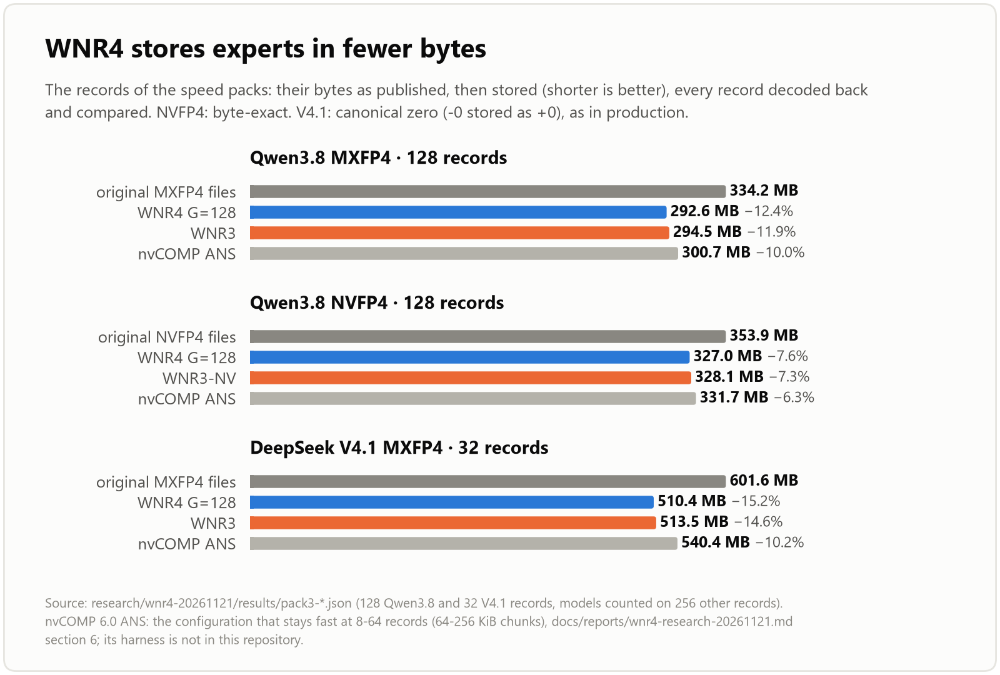
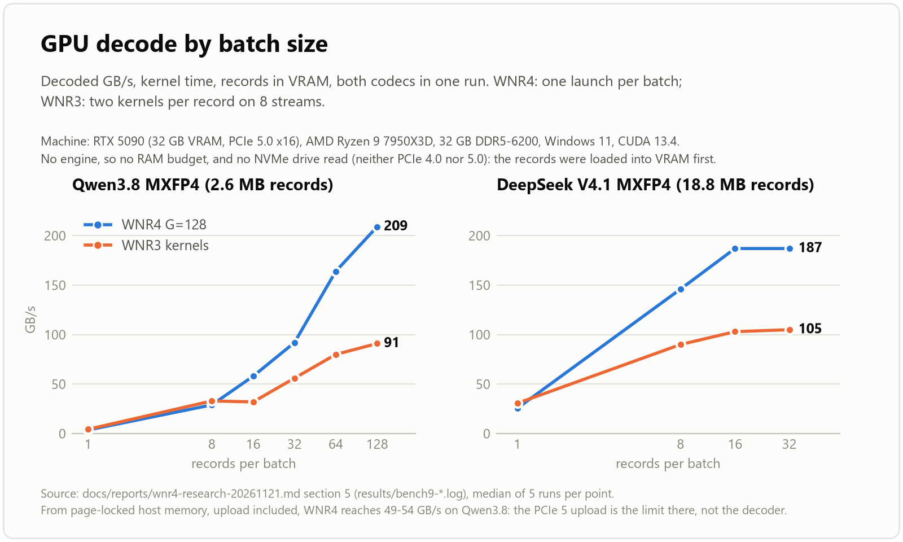
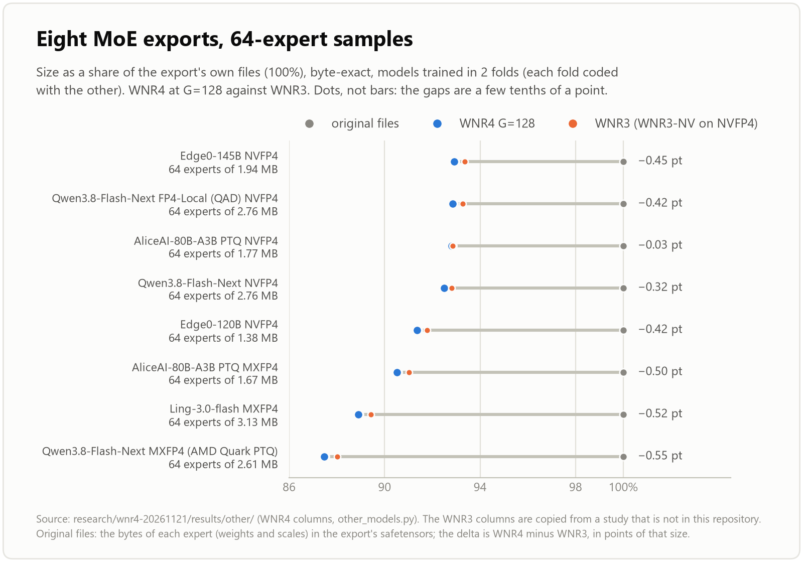

# WNR4 research (2026-11-21)

The measurements behind [docs/reports/wnr4-research-20261121.md](../../docs/reports/wnr4-research-20261121.md) and [docs/WNR4-SPEC.md](../../docs/WNR4-SPEC.md). Codec: `wnr4/wnr4.h` (CPU), `wnr4/wnr4_cuda.cuh` (CUDA), `wnr4/tools/wnr4_tools.c` (ctypes tool API), `wnr4/tools/wnr4_cuda_bridge.cu` (prototype helper DLL), `wnr4/tests/test_wnr4.c` (CPU tests and fuzz).

## Question

Can a successor of WNR3 store MXFP4 and NVFP4 routed experts in fewer bytes than WNR3 and decode them on the GPU at 40 GB/s or more (batched, straight into VRAM), so that compressed experts can beat re-reading RAW records?

## Setup

- Machine: one Windows 11 desktop, RTX 5090 (170 SMs; CUDA 13.4, `sm_120`, nvcc through `nvcc.cmd` with MSVC), Ryzen 9 7950X3D, 32 GB RAM. CPU code built with MSYS2 UCRT64 gcc.
- Data, read only: three WEX4 containers. Qwen3.8-Flash-Next MXFP4 (RAW records, 24,576 experts), the same model's NVFP4 export (24,576), DeepSeek V4.1 REAP-192 MXFP4 (WNR3-CZ records, 7,680; its records are decoded to the coded domain first). Paths come from the `WNR4_*` variables or `out/paths.json`.
- Ratio runs: models counted on 256 training records evenly spaced in (layer, expert) order, 2048 other records as the test set (seeded, the same number per layer); every test record encoded, decoded by the reference decoder and compared. WNR3 and WNR3-NV baselines encoded by their own encoders with models of the same 256 records.
- Speed runs: packs of 128 (Qwen3.8) and 32 (V4.1) test records (`out/packs3`), every record decoded on the GPU and compared before timing; kernel time = CUDA events around the one launch, median of 5.
- No engine build and no engine run: the codec is measured on its own. Commands: section "Rerun" below.

## Results

Stored / raw (records padded to 4096 B), 2048 held-out records each, every record decoded back and compared (Qwen3.8 byte-exact, V4.1 in the canonical-zero domain of its production records); kernel GB/s of decoded slab (best batch); from `results/measure-*.json` and `results/bench8-*.log`, `results/bench9-*.log`.

| container | WNR3 (same training records) | WNR4 G = 128 | WNR4 GPU kernel | WNR3 GPU kernels, same run |
|---|---:|---:|---:|---:|
| Qwen3.8 MXFP4 | 0.8809 | 0.8753 | 206-209 GB/s (batch 128) | 91 GB/s |
| Qwen3.8 NVFP4, byte-exact | 0.9271 (WNR3-NV) | 0.9238 | 140 GB/s | none (no GPU decoder) |
| DeepSeek V4.1 MXFP4 | 0.8539 | 0.8488 | 187-188 GB/s (batch 16-32) | 105 GB/s |

<picture>
  <source media="(prefers-color-scheme: dark)" srcset="charts/wnr4-ratio-dark.png">
  
</picture>

<picture>
  <source media="(prefers-color-scheme: dark)" srcset="charts/wnr4-gpu-dark.png">
  
</picture>

<picture>
  <source media="(prefers-color-scheme: dark)" srcset="charts/wnr4-models-dark.png">
  
</picture>

From page-locked host memory, upload included, WNR4 reaches 49-54 GB/s on Qwen3.8 MXFP4 (the PCIe 5 upload is the limit). The full tables, the G sweep, the CPU decoder, the nvCOMP and NVDEC baselines and the other models are in the [dated report](../../docs/reports/wnr4-research-20261121.md).

## Limits

- One machine and one GPU. Speed points are medians of 5 within one log; the same binary moved by up to ~30% between rounds, so compare numbers within one log.
- No engine run and no tok/s: what WNR4 would change in an engine is not measured here.
- The NVFP4 reader and the WNR3-NV baseline come from the `nvfp4-wnr3` branch, which is not public yet; the NVFP4 runs cannot be reproduced from this repository alone.
- The nvCOMP and NVDEC baselines of the report ran outside this repository (nvCOMP is a proprietary SDK); their harnesses are not included.
- The other models of the report are 64-expert samples, and their WNR3 columns are copied from a study that is not in this repository.
- The output of `stats/ctx2.py` and `stats/ctx3.py` was printed, not saved; `results/ctx3-console.txt` is a copy from the terminal.
- The CPU decoder is scalar (0.6-0.7 GB/s on 16-32 threads); no SIMD lane-parallel decoder was written.

## Raw files and scripts

| file | what |
|---|---|
| `data.py` | read-only access to the three containers (WEX4 reader), coded domain (canonical zero, WNR3 ceil form), train/test split |
| `stats/wnr4_stats.c`, `stats/run_stats.py` | held-out cross-entropy of weight and scale context models (first study) |
| `stats/ctx3.py` | held-out cross-entropy of further candidates (position, per-layer, scale contexts); prints only, its runs are copied in `results/ctx3-console.txt` |
| `stats/ctx2.py`, `stats/colrow.py`, `stats/colshare.py`, `stats/colprof.py` | in-sample bounds: position, column/row classes, column profiles shared across experts |
| `measure.py` | WNR4 vs WNR3 (same training records) on 2048 held-out records, every record decoded back and compared; `--pack` writes records for the GPU bench |
| `run_measure.sh` | the full ratio runs (results in `results/measure-*.json`) |
| `gpu/bench_gpu.cu` | GPU: bit-exact check of every pack record, single-bit flips, kernel-only GB/s by batch, end-to-end from page-locked host, WNR3 production helper and kernels on the same records |
| `gpu/test_helper.cu` | the helper API: batches from host into device slabs, status per record, corrupted record, unknown model, wrong owner |
| `gpu/bench_cpu.c` | CPU decode speed (reference decoder, OpenMP over tiles) and WNR3's CPU reference |
| `run_gpu_round.sh`, `run_cpu_round.sh`, `run_round8.sh`, `run_verify.sh` | GPU and CPU rounds; LOCKSH (optional) names a shell file with `take_lock LABEL` / `release_lock` for a machine-wide GPU lock |
| `literature.md` | literature and the transfer model |
| `charts.py`, `charts/` | the PNG charts of the README and the report (light and dark), drawn with `scripts/chartstyle.py` from `results/` and the report |
| `results/` | logs and JSON of the runs quoted in the docs (the WNR3 columns of the 64-expert sample table come from a study that is not in this repository) |

## Rerun

Paths: set `WNR4_Q38MX`, `WNR4_V41`, `WNR4_Q38NV` (containers) and `WNR4_NV_TREE` (a checkout of the `nvfp4-wnr3` branch, for its NVFP4-aware `wex4.py` and `c/tools/wex_nv_tools.c`; that branch, commit a96c4ff, is not on the public remote yet, so the NVFP4 runs and the WNR3-NV baseline cannot be reproduced from this repository alone), or put them in `out/paths.json`. Builds (MSYS2 UCRT64 gcc, CUDA 13 with MSVC through `nvcc.cmd`):

```
gcc -O3 -march=haswell -fopenmp -static -shared -o out/wnr4_tools.dll ../../wnr4/tools/wnr4_tools.c
gcc -O3 -march=haswell -static -shared -o out/wex_nr3_tools.dll ../../c/tools/wex_nr3_tools.c -I../../c
gcc -O3 -march=haswell -fopenmp -static -shared -o out/wex_nv_tools.dll $WNR4_NV_TREE/c/tools/wex_nv_tools.c -I$WNR4_NV_TREE/c
gcc -O2 -march=native -shared -o out/wnr4_stats.dll stats/wnr4_stats.c -lm
nvcc.cmd -O3 -std=c++17 -arch=sm_120 -Xcompiler /O2,/EHsc -o out/bench_gpu9.exe gpu/bench_gpu.cu
nvcc.cmd -O3 -std=c++17 -arch=sm_120 -Xcompiler /O2,/EHsc -o out/test_helper9.exe gpu/test_helper.cu
gcc -O2 -march=haswell -fopenmp -static -o out/bench_cpu.exe gpu/bench_cpu.c
gcc -O2 -fopenmp -static -o out/test_wnr4.exe ../../wnr4/tests/test_wnr4.c && out/test_wnr4.exe 3000
python -I measure.py q38mx results/measure-q38mx-cz.json --cz 1 --pb 5 --G 32,64,128,256
# the three packs of the GPU and CPU rounds (out/packs3; ratios in results/pack3-*.json)
python -I measure.py q38mx out/pack3-q38mx.json --train 256 --test 128 --G 128 --pb 5 --cz 1 --pack out/packs3 --pack-n 128 --pack-G 128
python -I measure.py q38nv out/pack3-q38nv.json --train 256 --test 128 --G 128 --pb 5 --cz 0 --pack out/packs3 --pack-n 128 --pack-G 128
python -I measure.py v41 out/pack3-v41.json --train 256 --test 32 --G 128 --pb 5 --cz 1 --pack out/packs3 --pack-n 32 --pack-G 128
bash run_verify.sh        # bench9-* and helper9-* logs
bash run_cpu_round.sh     # test_wnr4.log and cpu-* logs
```

The round scripts call numbered binaries, one number per round of the work: `run_verify.sh` the final source as built above (`bench_gpu9.exe`, `test_helper9.exe`); `run_gpu_round.sh` (the bench8-*, helper8-* and ncu8-* logs) `bench_gpu8.exe` and `test_helper8.exe`, built from the source before the review fixes (those added checks, one of them in the kernel, and changed the helper and the tests; the bench9 logs measure the kernel again after them). To rerun that round on the current source, build it under those names. The earlier bench3/bench6 and helper/helper6 logs came from earlier versions of the kernel and are kept as history only.

Generated data (`out/`: DLLs, packs of real records, binaries) is not tracked.
